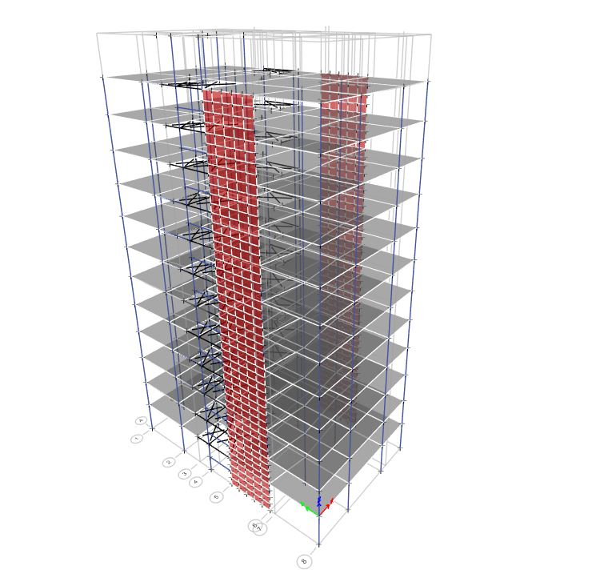
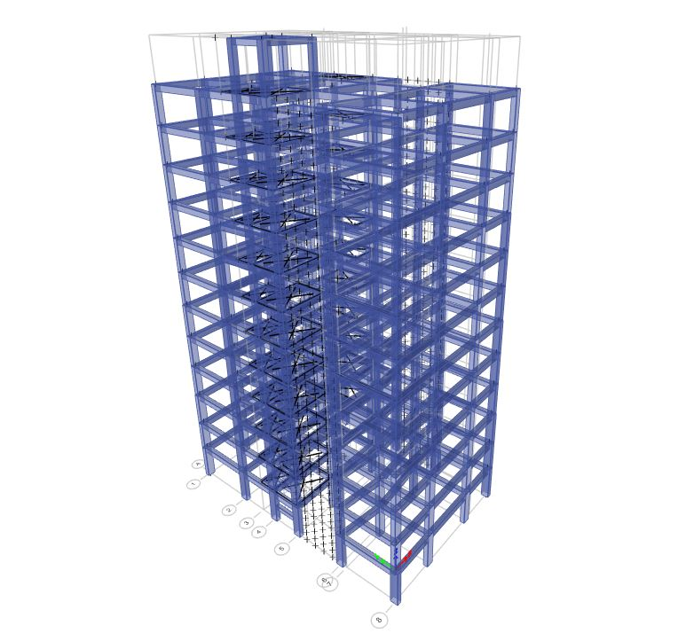
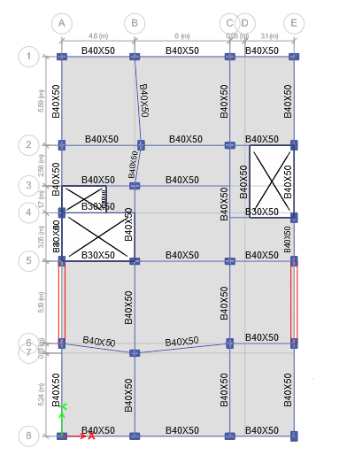
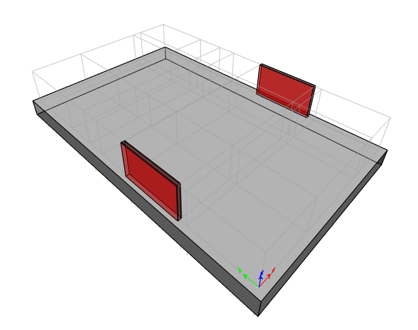

# Reinforced Concrete Structures Project

**Structural Analysis and Design of a 12-Level Reinforced Concrete Residential Building**



*Figure 1. Three-dimensional ETABS structural model of the reinforced concrete residential building.*

---

## Project Information

| Parameter | Details |
|---|---|
| Project Type | Team Academic Project (3 Students) |
| Course | Reinforced Concrete Structures |
| Institution | Amirkabir University of Technology (AUT) – Tehran Polytechnic |
| Location | Tehran, Iran |
| Building Occupancy | Residential |
| Software | ETABS, SAFE, AutoCAD |
| Retained Model Versions | ETABS 22.7.0, SAFE 22.7.0 |
| Design Codes | Iranian National Building Code Parts 6 and 9; Iranian Standard No. 2800 |

## Quick Access

- [Academic Project Brief (PDF)](project-brief/Concrete-Project-Brief.pdf)
- [Technical Reports and Engineering Calculations](report/)
- [ETABS, SAFE, and AutoCAD Files](software-files/)
- [Structural Model Images](images/)

---

## 1. Project Overview

This academic project involved the structural analysis and design of a 12-level reinforced concrete residential building in Tehran, Iran.

The building consists of one basement parking level, one ground-floor parking level, and ten residential floors, with a total floor area of approximately 4,452 m².

The selected lateral load-resisting system consists of intermediate moment-resisting frames combined with intermediate reinforced concrete shear walls. Alternative structural configurations were evaluated with respect to lateral stiffness and inter-storey drift control.

The project integrates manual engineering calculations, computational structural modeling, seismic analysis, reinforced concrete member design, foundation design, and structural material quantity estimation.

---

## 2. Building Specifications and Design Criteria

### Building Specifications

| Parameter | Specification |
|---|---|
| Number of Levels | 12 |
| Basement Parking Levels | 1 |
| Ground-Floor Parking Levels | 1 |
| Residential Floors | 10 |
| Typical Floor Area | 371 m² |
| Total Floor Area | 4,452 m² |
| Structural Material | Reinforced Concrete |
| Lateral Load-Resisting System | Intermediate Moment Frames and Intermediate Shear Walls |
| Floor System | Two-Way Waffle Slab |
| Foundation System | Mat Foundation |
| Soil Classification | Type I |
| Allowable Soil Bearing Capacity | 370 kPa |
| Required Fire Resistance | 90 minutes |

### Material Properties

| Material Property | Value |
|---|---:|
| Concrete Compressive Strength (f'c) | 37 MPa |
| Reinforcement Yield Strength (fy) | 400 MPa |
| Concrete Elastic Modulus | 32,694.8 MPa |
| Steel Elastic Modulus | 200,000 MPa |

### Design Codes and Standards

- Iranian National Building Code, Part 6 – Loads on Buildings.
- Iranian National Building Code, Part 9 – Design and Construction of Reinforced Concrete Buildings.
- Iranian Standard No. 2800 – Seismic Design of Buildings.

[View Academic Project Brief](project-brief/)

---

## 3. Engineering Methodology

The project followed an integrated engineering workflow combining manual calculations, numerical modeling, and code-based structural design.

### Engineering Workflow

1. Architectural review and structural system selection.
2. Preliminary sizing of structural members.
3. Manual gravity and seismic load calculations.
4. Three-dimensional structural modeling in ETABS.
5. Structural analysis and seismic performance assessments.
6. Reinforced concrete member and waffle slab design.
7. Foundation analysis and design in SAFE.
8. Durability and serviceability assessments.
9. Structural material quantity estimation.
10. Technical documentation and interpretation of results.

### Structural Loading

- Structural and non-structural dead loads.
- Residential, parking, and roof live loads.
- Snow loads and snow accumulation.
- Wind and elevator loads.
- Seismic load calculations.
- Effective seismic weight determination.
- Structural load combinations.

---

## 4. ETABS Structural Modeling and Seismic Analysis

A three-dimensional computational model was developed in ETABS to evaluate the structural response of the building under gravity and seismic loading.

### Modeling Procedure

- Definition of structural geometry and storey levels.
- Assignment of material and section properties.
- Modeling of beams, columns, slabs, and shear walls.
- Assignment of cracked-section stiffness modifiers.
- Shear wall meshing and diaphragm definition.
- Definition of mass sources and load combinations.
- Extraction of structural response and internal member forces.

### Three-Dimensional Beam and Column Model



*Figure 2. Three-dimensional ETABS model illustrating the reinforced concrete beam and column framing system.*

### Typical Structural Floor Plan



*Figure 3. Structural floor plan showing member section assignments, column locations, shear wall positions, slab openings, and structural grid dimensions.*

### Structural and Seismic Assessments

- Modal analysis and natural period evaluation.
- Modal mass participation assessment.
- Structural displacement and inter-storey drift evaluation.
- Torsional irregularity assessment.
- Overturning stability assessment.
- Interpretation of structural internal forces.

[Access Structural Model Files](software-files/)

---

## 5. Reinforced Concrete Member and Slab Design

The design of reinforced concrete members combined analytical engineering calculations with internal forces and design outputs obtained from ETABS.

### Beam Design

- Flexural, shear, and torsional design.
- Longitudinal reinforcement calculations.
- Transverse reinforcement and stirrup calculations.
- Reinforcement arrangement and member classification.

### Column Design

- Axial load and bending moment interaction.
- Longitudinal and transverse reinforcement calculations.
- Shear resistance assessment.
- Column section and reinforcement classification.

### Two-Way Waffle Slab Design

- Definition of slab geometry and section properties.
- Finite element meshing and design strip definition.
- Evaluation of bending moments and internal forces.
- Determination of reinforcement requirements.

### Durability and Serviceability

- Concrete cover and reinforcement detailing.
- Crack control and structural deformation considerations.
- Durability and fire-resistance requirements.

[View Detailed Engineering Calculations](report/)

---

## 6. Mat Foundation Analysis and Design in SAFE

Preliminary foundation bearing area calculations were performed using column reactions obtained from the ETABS structural model.

The estimated area required for isolated footings represented approximately 81% of the building footprint. Based on this preliminary assessment, a mat foundation was selected for the academic design.

### Foundation Specifications

| Parameter | Reported Value |
|---|---:|
| Building Footprint | 371 m² |
| Estimated Required Isolated Footing Area | 300.51 m² |
| Required Footing Area / Building Footprint | Approximately 81% |
| Selected Foundation System | Mat Foundation |
| Preliminary Foundation Thickness | 1,500 mm |

### Three-Dimensional Foundation Model



*Figure 4. Three-dimensional SAFE model illustrating the mat foundation geometry and reinforced concrete shear wall locations.*

### Foundation Modeling and Design

- Application of structural reactions.
- Definition of foundation geometry and soil subgrade properties.
- Finite element meshing and design strip definition.
- Soil bearing pressure assessment.
- Punching shear and one-way shear assessments.
- Flexural design and reinforcement calculations.
- Interpretation of foundation analysis results.

[Access SAFE Foundation Model](software-files/safe.FDB)

---

## 7. Selected Engineering Results

The following numerical values are reported in the original academic project documentation.

### Modal Analysis Results

| Parameter | Reported Result |
|---|---:|
| Fundamental Period – X Direction | 1.950 s |
| Fundamental Period – Y Direction | 1.785 s |
| Number of Vibration Modes | 24 |
| Cumulative Modal Mass Participation – X | 98.70% |
| Cumulative Modal Mass Participation – Y | 97.25% |

The reported cumulative modal mass participation exceeded 90% in both principal horizontal directions.

The original technical report also documents seismic loading, inter-storey drift, torsional irregularity, and overturning stability assessments.

### Model Verification and Documentation Note

The numerical values presented above are taken from the original academic report. A subsequent review of the retained ETABS model revealed differences in modal periods and mass participation results.

These differences have not yet been reconciled. Accordingly, the reported numerical results and retained computational models should not be interpreted as a fully reconciled or independently validated dataset.

[View Original Technical Report](report/)

---

## 8. Structural Material Quantity Estimation

Structural material quantities were estimated following the design of the main reinforced concrete components.

### Reported Material Quantities

| Material | Reported Quantity |
|---|---:|
| Total Concrete Volume | 1,512.81 m³ |
| Total Reinforcement | 239.33 t |
| Total Floor Area | 4,452 m² |

### Material Consumption Indicators

| Indicator | Calculated Value |
|---|---:|
| Concrete Volume per Floor Area | 0.340 m³/m² |
| Reinforcement per Floor Area | 53.76 kg/m² |
| Reinforcement per Concrete Volume | 158.20 kg/m³ |

These indicators were calculated using the reported aggregate material quantities and total floor area.

The quantity estimates illustrate the relationship between structural design decisions and material requirements.

[View Detailed Quantity Calculations](report/)

---

## 9. Personal Contribution and Academic Learning Outcomes

### Collaborative Contribution

This project was completed collaboratively by a team of three civil engineering students at Amirkabir University of Technology.

All team members participated jointly in the major stages of the project, including structural system selection, load calculations, computational modeling, structural analysis, member design, foundation design, material quantity estimation, and technical reporting.

My contribution extended across these stages through collaborative engineering calculations, computational modeling, design discussions, interpretation of numerical results, and technical documentation.

The project results and original technical report represent the collective work of the three team members.

### Academic Learning Outcomes

Through this project, I developed experience in:

- Multi-storey reinforced concrete structural systems.
- Structural and seismic design regulations.
- Integration of manual calculations and computational analysis.
- Interpretation of modal and seismic response results.
- Reinforced concrete member and foundation design.
- Finite element modeling and engineering simulation.
- Structural material quantity estimation.
- Technical reporting and collaborative engineering problem-solving.

---

## 10. Project Documentation and Resources

| Resource | Description | Access |
|---|---|---|
| Academic Project Brief | English summary of project requirements and design criteria | [View PDF](project-brief/Concrete-Project-Brief.pdf) |
| Original Academic Assignment | Original project requirements in Persian | [Open Directory](project-brief/) |
| Technical Report Summary | Concise overview of project methodology and results | [View Reports](report/) |
| Full Technical Report | Comprehensive 156-page engineering report in Persian | [View Reports](report/) |
| ETABS Structural Model | Retained numerical building model | [View File](software-files/project%20new%20model.EDB) |
| SAFE Foundation Model | Numerical model of the mat foundation | [View File](software-files/safe.FDB) |
| AutoCAD Drawings | Project CAD drawings | [View File](software-files/concrate%20project.dwg) |
| Additional CAD Drawings | Supporting drawing file | [View File](software-files/44.dwg) |
| Structural Model Images | Selected ETABS and SAFE visualizations | [View Gallery](images/) |

### Repository Structure

```text
01-Concrete-Structures/
├── README.md
├── images/
├── project-brief/
├── report/
└── software-files/
```

The original academic report is written in Persian. This English README summarizes the project methodology, technical scope, and selected engineering results for international academic review.

---

## Academic Disclaimer

This project was completed as part of undergraduate Civil Engineering coursework at Amirkabir University of Technology.

The models, calculations, and reported results are presented for academic documentation and graduate application purposes. They do not constitute independently verified or certified construction-ready engineering designs.

---

[Return to Main Civil Engineering Portfolio](../README.md)
