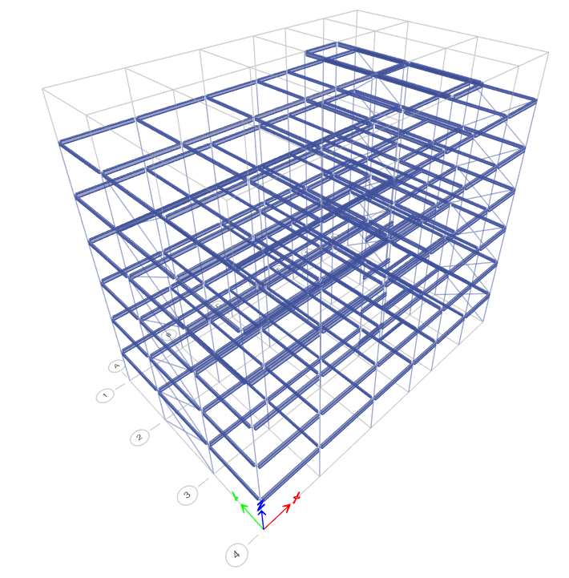
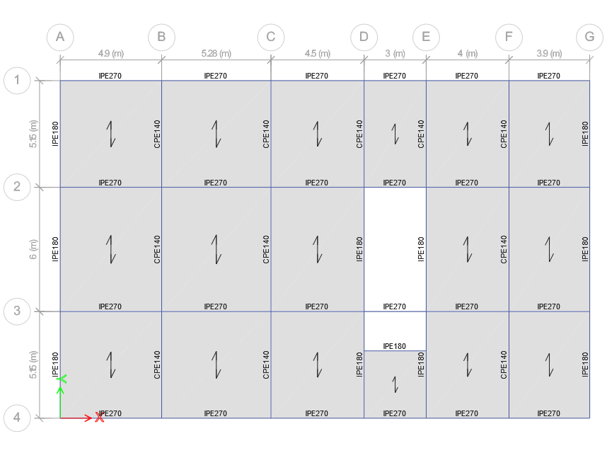
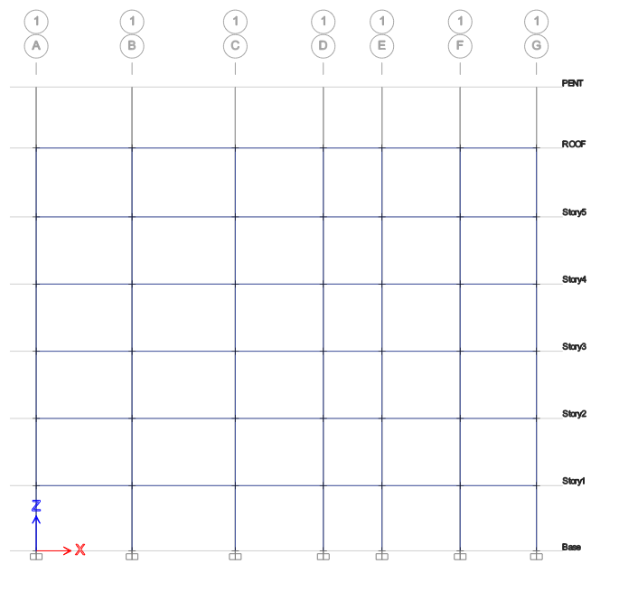
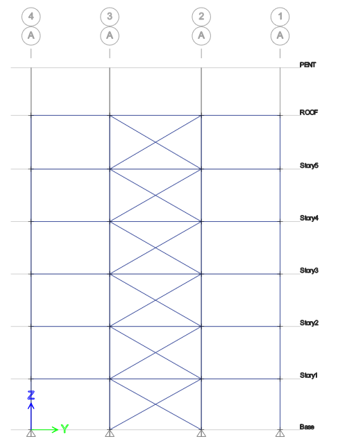

# Steel Structures Project

**Structural Analysis and Design of a Five-Storey Steel Residential Building**



*Figure 1. Three-dimensional ETABS model showing the steel framing system, beams, columns, and bracing configuration.*

---

| Project Information | Details |
|---|---|
| Project Type | Individual Academic Project |
| Course | Steel Structures |
| Institution | Amirkabir University of Technology (AUT) – Tehran Polytechnic |
| Location | Tehran, Iran |
| Building Occupancy | Residential |
| Software | ETABS, SAFE, AutoCAD |
| Retained Model Versions | ETABS 22.7.0, SAFE 22.7.0 |
| Design Codes | Iranian National Building Code, Part 10 (2022 edition; 2008 edition where applicable) |

### Quick Access

- [English Academic Project Brief (PDF)](project-brief/Steel-Project-Brief.pdf)
- [ETABS and SAFE Software Files](software-files/)
- [Analysis and Design Outputs](design-outputs/)
- [Project Images and Visualizations](images/)

---

## 1. Project Overview

This individual academic project involved the structural analysis and design of a multi-storey steel residential building in Tehran, Iran, as part of the undergraduate Civil Engineering program at Amirkabir University of Technology.

The building model includes five principal storeys, a roof level, and a penthouse level, with a maximum modeled elevation of 23.715 m above the base.

The lateral load-resisting system consists of intermediate steel moment-resisting frames in the X direction and a combination of simple steel frames and braced frames in the Y direction.

The project integrates structural system selection, manual engineering calculations, computational structural modeling, seismic analysis, steel member design, connection design, foundation analysis, and preparation of structural drawings.

The engineering workflow combines analytical calculations with numerical modeling and code-based design procedures.

---

## 2. Building Specifications and Design Criteria

### Building Specifications

| Parameter | Specification |
|---|---|
| Building Occupancy | Residential |
| Principal Storeys | 5 |
| Additional Modeled Levels | Roof and Penthouse |
| Structural Material | Steel |
| Grid-to-Grid Length (X Direction) | 25.58 m |
| Grid-to-Grid Width (Y Direction) | 16.30 m |
| Rectangular Grid Envelope Area | Approximately 416.95 m² |
| Main Roof Elevation | 20.595 m |
| Maximum Modeled Elevation | 23.715 m |
| Lateral System – X Direction | Intermediate Moment-Resisting Frames |
| Lateral System – Y Direction | Simple and Braced Steel Frames |
| Bracing Configuration | X-Bracing |
| Structural Analysis Software | ETABS |
| Foundation Analysis Software | SAFE |
| Structural Drafting Software | AutoCAD |

The plan dimensions were reconstructed from the structural grid spacing in the retained ETABS model. The rectangular grid envelope area represents the area enclosed by the outer structural grid lines and does not necessarily correspond to the net architectural floor area.

### Storey Geometry

| Level | Storey Height (m) | Elevation (m) |
|---|---:|---:|
| Penthouse | 3.120 | 23.715 |
| Roof | 3.520 | 20.595 |
| Story 5 | 3.435 | 17.075 |
| Story 4 | 3.435 | 13.640 |
| Story 3 | 3.435 | 10.205 |
| Story 2 | 3.435 | 6.770 |
| Story 1 | 3.335 | 3.335 |
| Base | — | 0.000 |

The storey heights and elevations were obtained from the ETABS Story Data definition. These values represent structural modeling dimensions rather than clear architectural ceiling heights.

### Design Codes and Standards

The project was developed with reference to the following Iranian structural design regulations:

- Iranian National Building Code, Part 6 – Loads on Buildings.
- Iranian National Building Code, Part 10 – Design and Construction of Steel Buildings, 2022 edition.
- Iranian National Building Code, Part 10, 2008 edition, where applicable to the original academic requirements.
- Iranian Standard No. 2800 – Seismic Design of Buildings.

[View English Academic Project Brief (PDF)](project-brief/Steel-Project-Brief.pdf)

---

## 3. Structural Layout and Framing System

The structural layout was developed with consideration of the architectural requirements, structural grid arrangement, gravity load transfer, lateral resistance, and practical member configuration.

### Structural Layout Development

- Definition of structural grid lines and bay dimensions.
- Arrangement of primary and secondary steel beams.
- Selection of column locations.
- Development of floor and roof framing systems.
- Integration of stair framing within the structural layout.
- Arrangement of moment-resisting and braced frames.
- Preliminary selection of steel member sections.

### Structural Floor Plan



*Figure 2. Representative structural floor plan showing grid dimensions, beam arrangement, assigned steel sections, and floor load-transfer directions.*

The structural floor plan illustrates the arrangement of primary and secondary framing members, including representative IPE and CPE sections assigned in the ETABS model.

### Structural Grid Dimensions

| Grid Interval – X Direction | Length (m) |
|---|---:|
| A–B | 4.90 |
| B–C | 5.28 |
| C–D | 4.50 |
| D–E | 3.00 |
| E–F | 4.00 |
| F–G | 3.90 |
| Total | 25.58 |

| Grid Interval – Y Direction | Length (m) |
|---|---:|
| 1–2 | 5.15 |
| 2–3 | 6.00 |
| 3–4 | 5.15 |
| Total | 16.30 |

---

## 4. Engineering Methodology

The project was developed through an integrated engineering workflow combining structural planning, analytical calculations, numerical modeling, and code-based design.

### Preliminary Structural Design

- Review of architectural and academic project requirements.
- Selection of appropriate structural framing systems.
- Preliminary sizing of beams and columns.
- Selection and arrangement of lateral load-resisting elements.
- Consideration of structural stability and practical member configuration.

### Structural Loading

The structural loading stage included consideration of:

- Structural and non-structural dead loads.
- Residential live loads.
- Parking and roof live loads.
- Snow loads.
- Seismic loads.
- Structural load combinations.

### Engineering Workflow

1. Review of architectural requirements and structural system selection.
2. Development of structural layout and preliminary member sizing.
3. Manual structural load calculations.
4. Three-dimensional structural modeling in ETABS.
5. Structural and seismic analysis.
6. Steel beam, column, and bracing design.
7. Approximate manual verification of frame behavior.
8. Steel connection and column base plate design.
9. Foundation modeling and design in SAFE.
10. Preparation of structural drawings and technical documentation.

---

## 5. ETABS Structural Modeling and Seismic Analysis

A three-dimensional computational model was developed in ETABS to evaluate the structural response of the building under gravity and seismic loading.

### Modeling Procedure

- Definition of structural grids and storey levels.
- Definition of steel material and section properties.
- Modeling of beams, columns, and braces.
- Assignment of floor and roof elements.
- Definition of structural support conditions.
- Assignment of gravity and seismic loads.
- Definition of structural load combinations.
- Extraction of structural response and internal member forces.

### Moment-Resisting Frame System – X Direction



*Figure 3. Elevation view along Grid 1 showing the steel framing configuration in the X direction.*

The X-direction lateral system was specified as an intermediate moment-resisting frame system in the academic project requirements.

The elevation illustrates the arrangement of beams and columns, structural bay configuration, and vertical continuity of the framing system.

### Braced Frame System – Y Direction



*Figure 4. Elevation view along Grid A showing the steel frame and X-bracing configuration in the Y direction.*

The Y-direction structural system incorporates simple steel frames and braced frames. The retained ETABS model illustrates the use of X-bracing within selected structural bays.

### Seismic Load Definition

User-defined equivalent static seismic load patterns were identified in the retained ETABS model.

| Seismic Parameter | X Direction | Y Direction |
|---|---:|---:|
| Load Pattern | EX | EY |
| Base Shear Coefficient (C) | 0.130 | 0.175 |
| Building Height Exponent (K) | 1.1625 | 1.0125 |
| Bottom Level | Base | Base |
| Top Level | PENT | PENT |

These parameters were extracted from the existing ETABS seismic load pattern definitions. They are documented as model inputs and have not been independently recalculated or verified against the original seismic design assumptions.

### Structural Response Assessments

The structural analysis stage included consideration of:

- Global structural displacement.
- Inter-storey drift.
- Structural internal forces.
- Lateral load distribution.
- Steel member design requirements.
- Structural stability and lateral stiffness.

[Access Structural Software Files](software-files/)

---

## 6. Steel Member Design

The steel member design stage combined structural analysis outputs with engineering calculations and the applicable steel design provisions.

### Beam Design

- Evaluation of bending moments and shear forces.
- Selection of appropriate steel beam sections.
- Flexural and shear resistance assessments.
- Consideration of member stability.
- Standardization of beam sections where practical.

Representative beam sections visible in the retained ETABS floor plan include IPE 270 and IPE 180.

### Column Design

- Evaluation of axial forces and bending moments.
- Selection of steel column sections.
- Consideration of combined axial and flexural behavior.
- Assessment of member stability and buckling.
- Use of built-up steel sections, including double-IPE configurations.

### Bracing System

- Arrangement of diagonal bracing members.
- Consideration of axial force transfer.
- Integration of bracing members with the surrounding steel framing.
- Consideration of member stability and connection requirements.

The member design process considered both structural resistance and practical section arrangement.

[View Analysis and Design Outputs](design-outputs/)

---

## 7. Manual Structural Analysis and Verification

Approximate manual structural analysis formed part of the academic project requirements.

The manual verification stage involved the approximate analysis of a representative moment-resisting frame using the Portal Method or Cantilever Method, followed by comparison with computational structural analysis results.

### Verification Objectives

- Develop an understanding of lateral load distribution.
- Estimate internal forces in representative structural members.
- Evaluate the approximate behavior of steel moment frames.
- Compare analytical calculations with numerical analysis outputs.
- Interpret differences between simplified analytical methods and computational modeling.

The integration of manual calculations and numerical analysis supported the interpretation of structural behavior and engineering design decisions.

The specific approximate method adopted and detailed comparison results are not reproduced in this summary.

---

## 8. Steel Connection Design and Structural Detailing

The connection design stage addressed the transfer of forces between steel structural members and their supporting elements.

### Beam-to-Column Moment Connections

- Consideration of bending moment and shear transfer.
- Design of rigid beam-to-column connections.
- Evaluation of connection plate requirements.
- Bolt and weld detailing.

### Simple Shear Connections

- Consideration of shear force transfer.
- Design of simple beam connections.
- Selection of connection components.
- Bolt and weld detailing.

### Column Base Plates

- Consideration of column reactions.
- Base plate design.
- Consideration of force transfer between steel columns and concrete foundations.
- Connection and anchorage detailing.

### Structural Detailing

The structural documentation stage included preparation of:

- Structural framing plans.
- Structural sections and elevations.
- Steel member details.
- Beam-to-column connection details.
- Column base plate details.
- Foundation drawings and details.

AutoCAD was used for structural drafting and detailing.

[Access Analysis and Design Documentation](design-outputs/)

---

## 9. Foundation Analysis and Design in SAFE

The foundation design stage formed part of the overall structural engineering workflow.

SAFE was used for foundation modeling and analysis, with consideration of structural reactions obtained from the ETABS model.

### Foundation Design Scope

- Application of structural support reactions.
- Definition of foundation geometry.
- Consideration of soil bearing requirements.
- Foundation modeling and structural analysis.
- Soil pressure assessment.
- Foundation design and detailing.

### Foundation Documentation Status

The original project included foundation analysis and design in SAFE. However, the foundation model has not been reopened and independently reanalyzed during the preparation of this English portfolio documentation.

The allowable soil bearing capacity, seismic soil classification, and detailed foundation design parameters have therefore not been reproduced here because their project-specific values could not be reliably confirmed.

[Access Foundation Software Files](software-files/)

---

## 10. Key Engineering Results

The following values summarize selected results reported in the previous project documentation and parameters extracted from the retained ETABS model.

### Structural Displacement Results

| Parameter | Reported Result |
|---|---:|
| Maximum Modeled Elevation | 23.715 m |
| Maximum Top-Level Displacement – X (EX) | 186 mm |
| Maximum Top-Level Displacement – Y (EY) | 62 mm |

### Inter-Storey Drift Results

| Parameter | Reported Result | Critical Storey |
|---|---:|---|
| Maximum Storey Drift Ratio – X | 0.0016 | Story 3 |
| Maximum Storey Drift Ratio – Y | 0.0017 | Story 4 |

### Engineering Interpretation

The structural displacement and inter-storey drift results provide information about the lateral response of the building under the defined seismic loading conditions.

The use of different lateral load-resisting systems in the two principal directions is an important consideration when interpreting the directional response of the structure.

The displacement and drift values are retained academic results and have not been independently reproduced through a new software analysis.

These reported values should not be interpreted as independent confirmation of seismic code compliance. Such confirmation would require verification of the applicable load cases, displacement amplification factors, drift limits, and original design assumptions.

[View Available Analysis and Design Outputs](design-outputs/)

---

## 11. Individual Project Contribution and Academic Learning Outcomes

### Individual Contribution

This project was completed individually as part of the undergraduate Steel Structures coursework at Amirkabir University of Technology.

My contribution covered the major stages of the structural engineering workflow, including:

- Structural system selection and framing layout.
- Preliminary structural member sizing.
- Structural load calculations.
- Three-dimensional computational modeling in ETABS.
- Structural and seismic analysis.
- Steel beam and column design.
- Approximate manual structural analysis and verification.
- Steel connection design.
- Foundation modeling and design in SAFE.
- Structural drafting and detailing in AutoCAD.
- Preparation of engineering documentation.

### Academic Learning Outcomes

Through this project, I developed experience in:

- Structural behavior of multi-storey steel buildings.
- Selection and arrangement of steel lateral load-resisting systems.
- Application of steel and seismic design regulations.
- Computational structural modeling and analysis.
- Interpretation of structural displacement and drift results.
- Steel member design and stability considerations.
- Steel connection design and structural detailing.
- Integration of manual calculations with computational analysis.
- Foundation modeling and soil pressure assessment.
- Independent engineering problem-solving and technical documentation.

The project strengthened my academic foundation in structural engineering, steel design, and computational analysis, providing relevant preparation for graduate-level studies in Civil Engineering.

---

## 12. Project Documentation and Resources

The retained project materials are organized into the following directories.

| Resource | Description | Access |
|---|---|---|
| English Academic Project Brief | Reconstructed English summary of the academic requirements and confirmed project specifications | [View PDF](project-brief/Steel-Project-Brief.pdf) |
| Project Brief Directory | Academic project requirements and supporting documentation | [Open Directory](project-brief/) |
| ETABS Structural Model | Retained numerical model of the steel building | [View Software Files](software-files/) |
| SAFE Foundation Model | Retained foundation analysis and design files | [View Software Files](software-files/) |
| Analysis and Design Outputs | Available structural analysis and design documentation | [View Outputs](design-outputs/) |
| 3D Structural Model | Three-dimensional steel structural model visualization | [View Image](images/etabs-3d-model.png) |
| Structural Floor Plan | Representative floor framing arrangement and assigned sections | [View Image](images/structural-floor-plan.png) |
| Moment Frame Elevation | Structural framing elevation in the X direction | [View Image](images/moment-frame-elevation.png) |
| Braced Frame Elevation | X-bracing configuration in the Y direction | [View Image](images/braced-frame-elevation.png) |
| Project Visualizations | Collection of structural model images | [View Images](images/) |

### Software Versions

- ETABS 22.7.0 – Retained structural model version.
- SAFE 22.7.0 – Reported retained foundation model version.
- AutoCAD – Structural drafting and detailing.

Selected structural model visualizations were subsequently prepared using ETABS 23.3.2 for portfolio documentation.

### Repository Structure

```text
02-Steel-Structures/
│
├── README.md
│
├── images/
│   ├── README.md
│   ├── etabs-3d-model.png
│   ├── structural-floor-plan.png
│   ├── moment-frame-elevation.png
│   └── braced-frame-elevation.png
│
├── project-brief/
│   ├── README.md
│   └── Steel-Project-Brief.pdf
│
├── design-outputs/
│
└── software-files/
```

The English academic project brief and this README were prepared retrospectively to summarize the project requirements, engineering methodology, confirmed model parameters, and selected academic results for international academic review.

---

## Academic Disclaimer

This project was completed as part of undergraduate Civil Engineering coursework at Amirkabir University of Technology.

The English project brief is a reconstructed academic summary and is not an official university-issued document or certified translation.

The structural models, calculations, visualizations, and reported results are presented for academic documentation and graduate application purposes.

The retained results have not been independently revalidated through a new comprehensive structural analysis. The project does not constitute an independently verified or certified construction-ready engineering design.

---

[Return to Main Civil Engineering Portfolio](../README.md)
