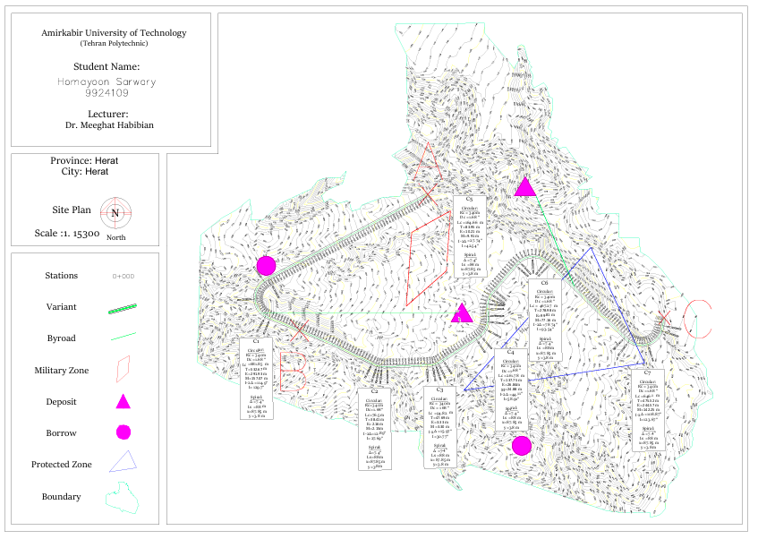
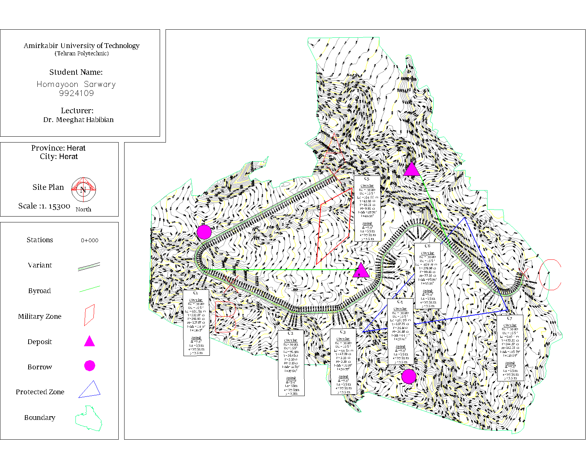
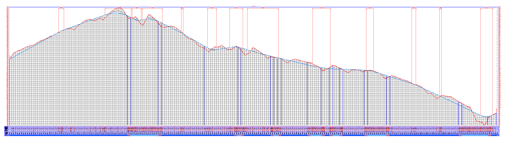
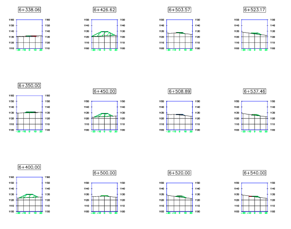
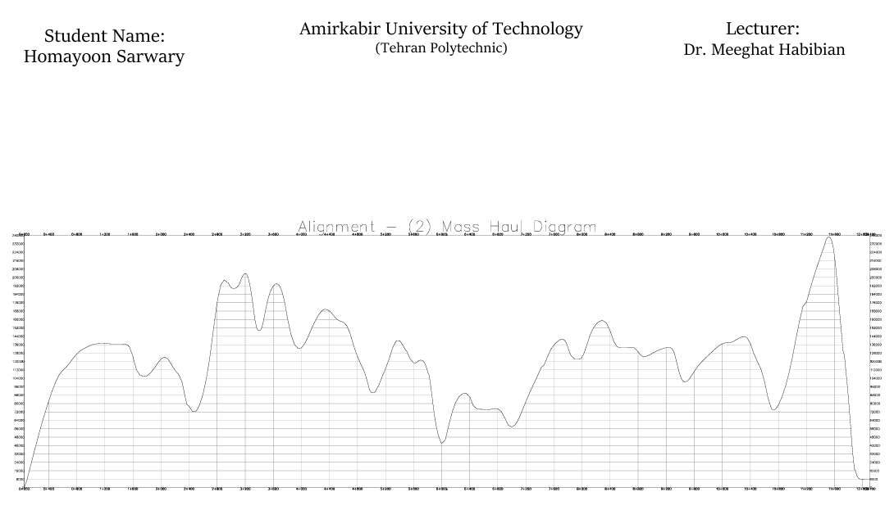
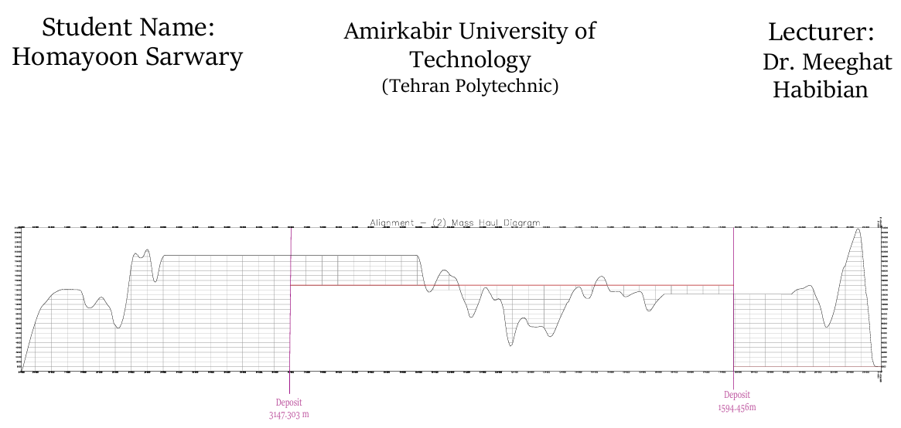
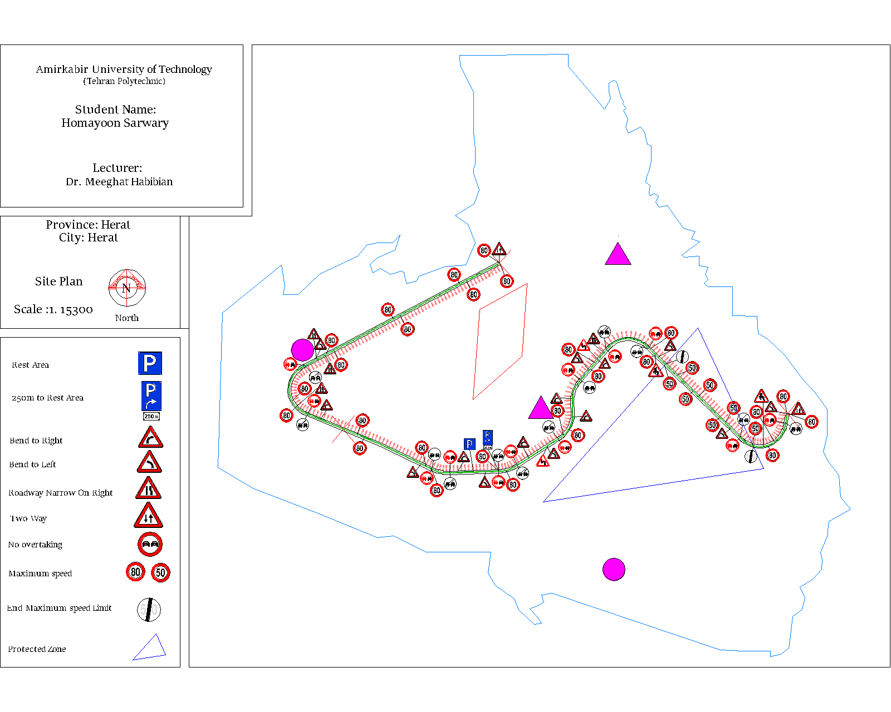

# Road Engineering Project: Herat, Afghanistan

**Type:** Individual Route Design within a Group Report (Group 6, Four Members)  
**Course:** Road Engineering, Amirkabir University of Technology (AUT), 2024–2025  
**Software:** Autodesk Civil 3D, AutoCAD  
**Geometric Design Standard:** Iranian Publication No. 800-1  
**Pavement Design Method:** AASHTO

## Overview

Design of a 12.1 km, two-lane, two-way Class 1 collector-distributor road in Herat, Afghanistan, based on provided topographic data. The project considered borrow pits, disposal sites, protected-area constraints, and the restriction against bridges and tunnels.

The report was prepared in a group-report format. My route, calculations, and results are identified by my name in the relevant sections.

*Overview of the designed road alignment and surrounding topography.*

## Design Basis

| Item | Value |
|---|---|
| Design Speed | 80 km/h |
| Road Width | 2 × 3.6 m lanes + 2 × 1.8 m shoulders (10.8 m total) |
| Right-of-Way | 22.5 m on each side of the road axis |
| Maximum Superelevation | 10% (applied within the spirals) |
| Longitudinal Grade | 0.3% to 6% |
| Route Length | Approximately 12,131 m |

## Scope of Work

- **Route Selection:** Contour-based compass stepping, considering route length, borrow and disposal site locations, maximum gradient, and cut-and-fill balance.
- **Horizontal Alignment:** 7 horizontal curves with transition spirals, superelevation, side-friction checks, curve widening, and stake-out tables.
- **Vertical Alignment:** 13 parabolic vertical curves (8 crest and 5 sag), with gradient and curve-length checks.
- **Sight Distance:** Sight-distance and lateral-clearance evaluations.
- **Hydrology and Drainage:** Runoff estimation and design of drainage channels and culverts.
- **Earthwork:** Civil 3D cross-sections, cut-and-fill volumes, and original and adjusted mass-haul (Brückner) diagrams.
- **Pavement Design:** AASHTO-based design, including equivalent axle loads, ESAL calculations, and pavement layer thicknesses.
- **Road Signage and Markings:** Preparation of the traffic signage and road marking plan.
- **Quantities and Cost:** Quantity takeoff and cost estimation based on the 2024 unit-price list.

## Geometric Design

### Horizontal Alignment

*Detailed horizontal alignment plan illustrating the designed road geometry and route configuration.*

### Vertical Alignment

*Longitudinal profile illustrating the existing terrain, proposed road elevations, longitudinal gradients, and vertical curves.*

### Road Cross Sections

*Selected road cross-sections developed in Autodesk Civil 3D, illustrating the roadway geometry and earthwork conditions.*

## Earthwork Analysis

Earthwork analysis included the calculation of excavation and embankment quantities and the development of mass-haul diagrams to evaluate material distribution along the designed route.

### Original Mass-Haul Diagram

*Original mass-haul (Brückner) diagram illustrating cumulative earthwork quantities along the route.*

### Adjusted Mass-Haul Diagram

*Adjusted mass-haul diagram developed as part of the earthwork balancing and material distribution analysis.*

## Traffic Signage and Road Markings

*Traffic signage and road marking plan prepared as part of the road engineering design.*

## Selected Results

| Item | Value |
|---|---|
| Route Length | Approximately 12.13 km |
| Horizontal Curves | 7 |
| Vertical Curves | 13 |
| Total Excavation | Approximately 822,690 m³ |
| Estimated Project Cost | Approximately 1,553 billion Iranian rial (IRR), equivalent to 155.3 billion toman |

## My Contribution

Individually completed the design of my assigned route, including route selection, horizontal and vertical alignment, earthwork calculations, and cost estimation.

Shared chapters covering regional descriptions, design assumptions, and hydrological methods were prepared jointly by the group.

## Project Files

| Section | Description |
|---|---|
| [Project Brief](project-brief/) | Project requirements, design objectives, and introductory documentation. |
| [English Report Summary](report/Road-Engineering-Report-Summary.pdf) | Concise English summary of the engineering design and selected results. |
| [Full Group Report and Documentation](report/) | Detailed academic report, calculations, and supporting documentation. |
| [Software Files](software-files/) | Original Autodesk Civil 3D and AutoCAD project files. |
| [Design Outputs](design-outputs/) | Engineering design outputs and supporting calculations. |
| [Drawings and Images](images/) | Selected engineering drawings, profiles, cross-sections, and diagrams. |

---

*This project was completed as part of an academic road engineering course and is presented for portfolio demonstration purposes.*
