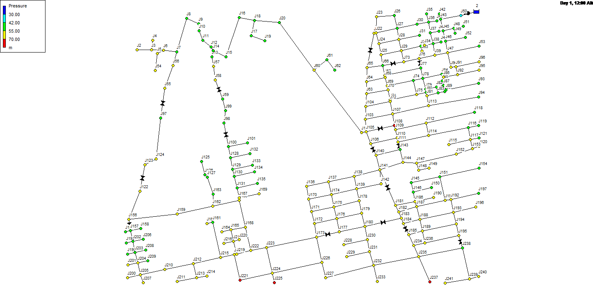
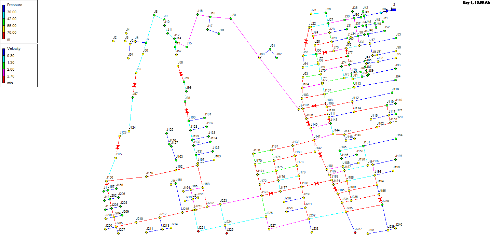
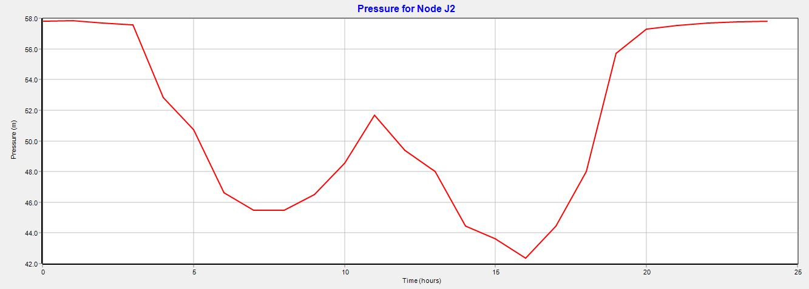
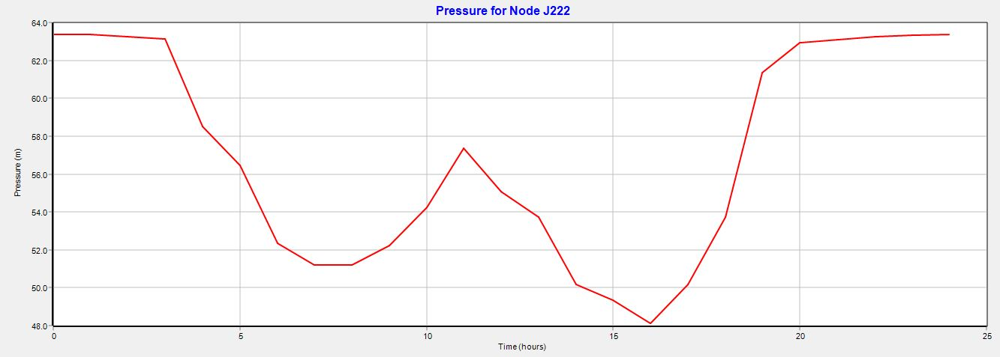
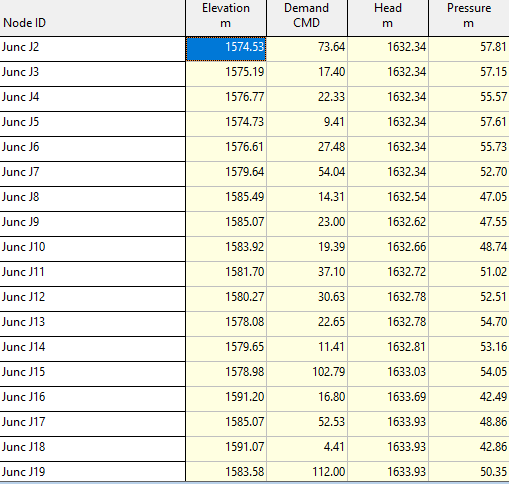

# Water Distribution Network Design: West Saadat Abad, Tehran, Iran

**Type:** Team Academic Project (3 Students)  
**Course:** Water and Wastewater Engineering, Amirkabir University of Technology (AUT), 2024–2025  
**Software:** EPANET, Autodesk Civil 3D, AutoCAD, Microsoft Excel, Python  
**Design Reference:** Iranian Publication No. 117-3 (Urban Water Supply Design Criteria)

## Project Overview

Design and hydraulic analysis of an urban water distribution network for the western Saadat Abad district of Tehran, Iran.

The study area covers approximately 1.9 km² and had an estimated population of 23,157 in 2021. The project involved terrain modeling, network layout, population forecasting, water-demand estimation, hydraulic design, pump selection, storage calculations, and extended-period simulation using EPANET.

## Network Overview

*EPANET network layout and simulated nodal pressure distribution.*

## Design Basis

| Parameter | Design Value |
|---|---|
| Study Area | West Saadat Abad, Tehran (approx. 1.9 km²) |
| Initial Population | 23,157 (2021) |
| Design Period | 25 years |
| Population Forecasting Method | Curvilinear method |
| Annual Population Growth Rate | 1.24% |
| Domestic Water Consumption | 110 L/person/day |
| Water Loss Allowance | 15% |
| Maximum Daily Demand Factor (C1) | 1.4 |
| Maximum Hourly Demand Factor (C2) | 1.5 |
| Pipe Material | PVC |
| Main Loop Diameter | 700 mm |
| Simulation Period | 24 hours |
| Simulation Time Step | 1 hour |

## Hydraulic Design Criteria

### Pressure

- Target pressure: approximately 30 m at most nodes.
- Minimum service pressure at ground-floor level: 14 m, plus 4 m for each additional floor.
- Maximum pressure: approximately 50–70 m.
- Pressure zoning and pressure-breaker valves (PBVs) were considered to manage elevation-related pressure differences.

### Flow Velocity

- Minimum: 0.3 m/s.
- Maximum under normal operation: 2.0 m/s.
- Maximum under fire-flow conditions: 2.5 m/s.

### Pipe Diameter

- Minimum diameter: 60 mm.
- Minimum diameter for pipes equipped with fire hydrants: 110 mm.

### Fire Protection

- Hydrant spacing: 100 m in important areas, 200 m in residential areas, and up to 300 m in lower-value areas, subject to the specified pipe-diameter requirements.

## Scope of Work

- **Terrain Modeling:** Extraction of elevation data from AutoCAD drawings and development of a ground surface model in Civil 3D.
- **Network Layout:** Placement of junctions at street intersections and routing of pipes along the street network, using looped arrangements where feasible.
- **Data Extraction:** Transfer of junction coordinates and pipe geometry from Civil 3D and AutoCAD into Excel for model preparation.
- **Service-Area Allocation:** Delineation of junction service areas using perpendicular bisectors and Voronoi polygons generated with Python.
- **Land-Use Analysis:** Classification of residential, educational, hospital, green-space, commercial, and other land uses for water-demand allocation.
- **Population Forecasting and Demand Estimation:** Calculation and allocation of domestic, institutional, green-space, and water-loss demands to individual junctions.
- **Storage Design:** Development of hourly demand patterns and calculation of balancing storage requirements.
- **Hydraulic Modeling:** Development of the EPANET network model, including junctions, pipes, reservoirs, pumps, and valves.
- **Pump Selection:** Selection based on peak flow and required head using technical data from the Pumpiran catalogue.
- **Extended-Period Simulation:** Evaluation of pressure, hydraulic head, pipe flow, velocity, and friction losses over a 24-hour simulation period.
- **Water Quality Analysis:** Modeling of residual chlorine concentration and its bulk and wall decay throughout the network.

## Selected Design Results

| Parameter | Result |
|---|---:|
| Number of Junctions | 241 |
| Average Daily Demand | 12,973.4 m³/day |
| Maximum Daily Demand | 19,460.16 m³/day |
| Pump Design Flow | 810.84 m³/h |
| Required Pump Head | 25.5 m |
| Junction Elevation Range | 1,521.71–1,630.50 m |
| Total Elevation Difference | 108.79 m |
| Main Loop Pipe Diameter | 700 mm |

## Hydraulic Simulation Results

Selected visual outputs from the EPANET hydraulic model illustrate the spatial distribution of hydraulic parameters and their variation throughout the 24-hour simulation period.

### Pressure and Flow Velocity Distribution

*Combined visualization of nodal pressures and pipe flow velocities across the distribution network.*

### Extended-Period Pressure Analysis

Pressure time-series results were examined at selected network junctions to evaluate daily pressure variations under changing water-demand conditions.

#### Junction J2

*Simulated pressure variation at Junction J2 over the 24-hour analysis period.*

#### Junction J222

*Simulated daily pressure variation at Junction J222.*

### Junction Hydraulic Results

*Selected EPANET tabular results showing junction elevations, water demands, hydraulic heads, and pressures.*

## Water Quality Analysis

Residual chlorine was modeled in EPANET to examine chlorine decay throughout the distribution network.

- Continuous chlorine dosing at the tank: 1.0 mg/L.
- Bulk reaction coefficient: −0.85.
- Wall reaction coefficient: −0.015.

## Design Limitations

Despite several pipe-diameter adjustments, flow velocities at some locations remained above the specified maximum allowable limit.

This limitation was identified during the hydraulic analysis and remains an area for further network optimization.

## Team Contribution

This project was completed collaboratively by a team of three students.

I contributed to the shared engineering activities, including terrain modeling, network drafting, data extraction, service-area allocation, population forecasting, demand calculations, EPANET modeling, pump and storage design, hydraulic simulation, water quality analysis, and report preparation.

The major design decisions, calculations, and project documentation were developed jointly through team discussion and collaborative work.

## Project Files

| Resource | Description |
|---|---|
| [Project Brief](project-brief/) | Original project requirements and English project brief. |
| [English Report Summary](report/Water-Distribution-Report-Summary.pdf.pdf) | English summary of the engineering methodology and project results. |
| [Full Group Report (Persian)](report/Water-Distribution-Full-Report-FA.pdf.pdf) | Original academic group report. |
| [Software Files](software-files/) | Original EPANET model and associated CAD files. |
| [Design Outputs](design-outputs/) | Engineering design calculations and supporting documentation. |
| [Project Images](images/) | Network maps, hydraulic results, and pressure time-series graphs. |

---

*This project is presented as part of an academic civil engineering portfolio.*

[Back to Civil Engineering Portfolio](../README.md)
