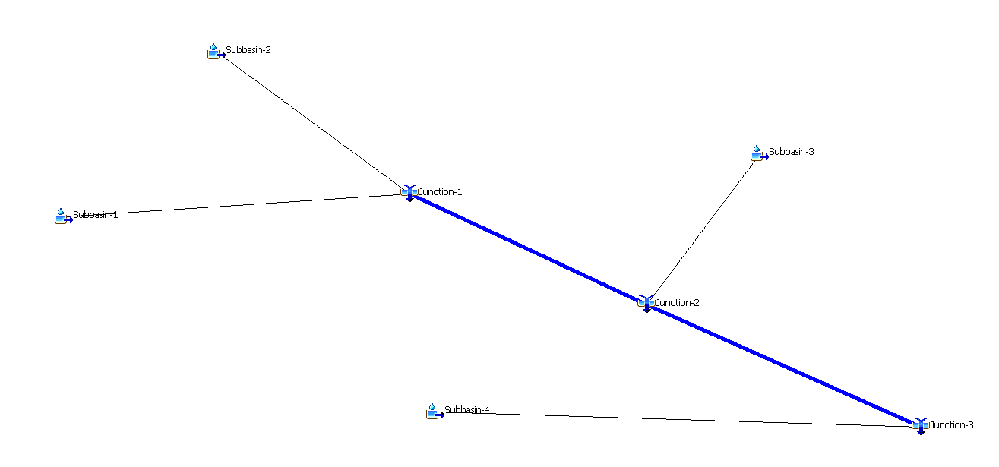
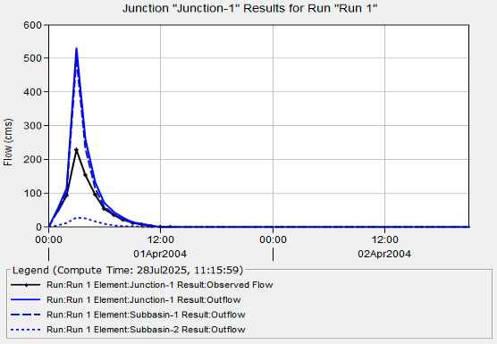
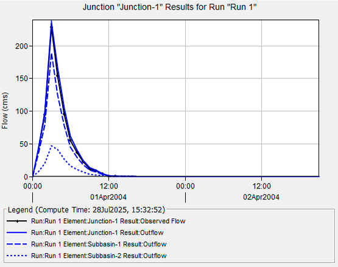
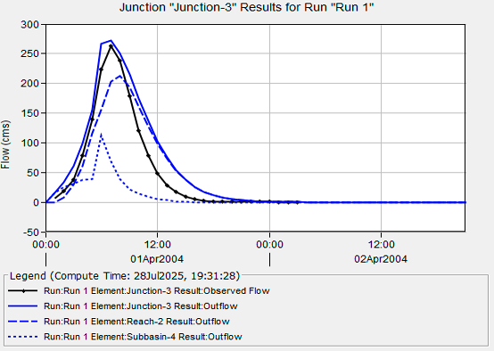
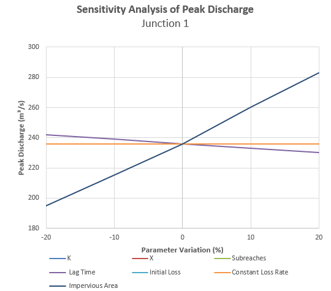

# Rainfall-Runoff Modeling and Calibration Using HEC-HMS

**Project Type:** Individual Academic Project  
**Course:** Engineering Hydrology  
**University:** Amirkabir University of Technology (AUT)  
**Date:** August 2025  
**Software:** HEC-HMS, Microsoft Excel  

## Project Overview

Development, simulation, and calibration of a rainfall-runoff model for a hypothetical watershed covering approximately 1,029 km².

The project involved hydrological model development, rainfall-runoff simulation, manual parameter calibration, hydrograph comparison, and sensitivity analysis.

The model was developed using rainfall data at 15-minute intervals for the storm event of 1 April 2004 and hourly observed discharge hydrographs at two calibration locations.

## Key Results

| Performance Indicator | Junction 1 | Junction 3 |
|---|---:|---:|
| Observed peak discharge (m³/s) | 228.7 | 263.1 |
| Final simulated peak discharge (m³/s) | 235.9 | 271.7 |
| Absolute peak discharge error | 3.15% | 3.27% |
| Nash-Sutcliffe Efficiency (NSE) | 0.994 | 0.888 |
| Reported percent bias | 6.29% | 35.67% |
| Observed peak time | 03:00 | 07:00 |
| Simulated peak time | 03:00 | 07:00 |

## Watershed Model Configuration

| Parameter | Description |
|---|---|
| Total watershed area | 1,029 km² |
| Number of subbasins | 4 |
| Subbasin areas | 461, 127, 310, and 131 km² |
| Number of junctions | 3 |
| Number of reaches | 2 |
| Precipitation input | Two specified hyetographs |
| Rainfall data interval | 15 minutes |
| Observed discharge interval | 1 hour |
| Loss method | Initial and Constant |
| Transform method | SCS Unit Hydrograph |
| Peak rate factor (PRF) | 484 |
| Routing method | Muskingum |
| Calibration method | Manual calibration |
| Simulation start | 1 April 2004, 00:00 |
| Simulation end | 2 April 2004, 21:00 |

### Basin Model

*Figure 1. HEC-HMS basin model consisting of four subbasins, three junctions, and two routing reaches.*

## Engineering Workflow

1. Preparation of watershed characteristics and hydrological input data.
2. Development of the HEC-HMS basin model.
3. Configuration of precipitation inputs and meteorological model.
4. Assignment of loss, transform, and routing parameters.
5. Initial rainfall-runoff simulation.
6. Progressive manual calibration from upstream to downstream.
7. Comparison of observed and simulated discharge hydrographs.
8. Evaluation of model performance using statistical indicators.
9. Sensitivity analysis of selected hydrological parameters.
10. Interpretation and documentation of simulation results.

## Model Calibration

Manual calibration was performed progressively, beginning at Junction 1 and continuing downstream to Junction 3.

Selected parameters, including impervious area percentage, initial loss, constant loss rate, and Muskingum K, were adjusted to improve agreement between observed and simulated hydrographs.

Model performance was evaluated using peak discharge, runoff volume, peak timing, Nash-Sutcliffe Efficiency (NSE), and percent bias.

### Junction 1 Calibration

| Calibration Stage | Peak Discharge (m³/s) | Runoff Volume (mm) | NSE | Reported Percent Bias |
|---|---:|---:|---:|---:|
| Observed | 228.7 | 4.50 | — | — |
| Initial simulation | 530.4 | 7.78 | -0.838 | 67.7% |
| Intermediate calibration | 294.3 | 5.02 | 0.917 | 8.1% |
| Final calibrated model | 235.9 | 4.93 | 0.994 | 6.29% |

#### Before Calibration

*Figure 2. Initial simulated and observed discharge hydrographs at Junction 1.*

#### After Calibration

*Figure 3. Final calibrated discharge hydrograph at Junction 1.*

The calibration process substantially improved model performance, increasing NSE from -0.838 to 0.994 and reducing the absolute peak discharge error from approximately 131.9% to 3.15%.

### Junction 3 Calibration

| Calibration Stage | Peak Discharge (m³/s) | Runoff Volume (mm) | NSE | Reported Percent Bias |
|---|---:|---:|---:|---:|
| Observed | 263.1 | 5.20 | — | — |
| Initial simulation | 269.0 | 7.28 | 0.831 | 39.5% |
| Final calibrated model | 271.7 | 7.08 | 0.888 | 35.67% |

*Figure 4. Final simulated and observed discharge hydrographs at Junction 3.*

The calibrated model reproduced the observed peak timing and achieved an absolute peak discharge error of approximately 3.27%. Although overall hydrograph agreement improved, the simulated runoff volume remained higher than the observed volume.

## Sensitivity Analysis

A sensitivity analysis was conducted to investigate the influence of seven hydrological parameters on the simulated rainfall-runoff response:

- Impervious area percentage
- Muskingum K
- Muskingum X
- Number of subreaches
- SCS lag time
- Initial loss
- Constant loss rate

The analysis considered parameter variations of ±10% and ±20% relative to the baseline configuration.

The evaluated response characteristics included:

- Peak discharge
- Total runoff volume
- Rising and falling limbs of the hydrograph
- Time to peak
- Hydrograph base time

### Peak Discharge Sensitivity at Junction 1

*Figure 5. Sensitivity of simulated peak discharge to hydrological parameter variations at Junction 1.*

| Parameter | -20% | -10% | Baseline | +10% | +20% |
|---|---:|---:|---:|---:|---:|
| Impervious area | 195 | 215 | 236 | 260 | 283 |
| SCS lag time | 242 | 239 | 236 | 233 | 230 |
| Muskingum K | 236 | 236 | 236 | 236 | 236 |
| Muskingum X | 236 | 236 | 236 | 236 | 236 |
| Subreaches | 236 | 236 | 236 | 236 | 236 |
| Initial loss | 236 | 236 | 236 | 236 | 236 |
| Constant loss rate | 236 | 236 | 236 | 236 | 236 |

*Peak discharge values are expressed in m³/s and rounded to whole numbers.*

Impervious area percentage exhibited the strongest influence on peak discharge at Junction 1 within the tested parameter range.

SCS lag time showed a smaller inverse relationship with peak discharge. The remaining parameters produced no noticeable changes in the reported Junction 1 peak discharge at the displayed precision.

These findings are specific to the selected model configuration, storm event, evaluation location, and parameter variation range.

## Model Limitations

- Calibration was based on a single rainfall event.
- Independent validation using additional storm events was not documented.
- Runoff volume at Junction 3 remained overestimated, despite satisfactory peak discharge and peak timing agreement.
- The sensitivity analysis reflects the selected parameter ranges and model configuration.
- Reported percent bias values were retained from the available calibration results and may differ from direct calculations using the displayed runoff volumes.

The model was developed for academic purposes and should not be interpreted as an independently validated operational flood forecasting model.

## Individual Contribution

This project was completed individually as part of the Engineering Hydrology course.

My responsibilities included:

- Hydrological input data preparation.
- Watershed and basin model development.
- HEC-HMS model configuration.
- Rainfall-runoff simulation.
- Manual parameter calibration.
- Hydrograph and statistical performance evaluation.
- Hydrological parameter sensitivity analysis.
- Engineering interpretation and technical report preparation.

## Technical Skills Demonstrated

- Hydrological modeling
- Rainfall-runoff simulation
- Watershed analysis
- SCS Unit Hydrograph method
- Muskingum flow routing
- Manual model calibration
- Hydrograph interpretation
- Model performance evaluation
- Parameter sensitivity analysis
- Engineering data processing
- Technical documentation

## Project Files

| Section | Description |
|---|---|
| [Project Brief](project-brief/) | Project objectives, scope, and introductory documentation |
| [Project Reports](report/) | English technical summary and original Persian report |
| [HEC-HMS Model Files](software-files/) | Original model archive and supporting log files |
| [Simulation Results and Design Outputs](design-outputs/) | Hydrological input data and supporting calculations |
| [Project Images](images/) | Basin model, hydrographs, calibration statistics, and sensitivity analysis |

## Academic Context

This project was completed as an individual academic assignment for the Engineering Hydrology course at Amirkabir University of Technology (AUT).

The materials are presented for academic documentation and engineering portfolio purposes.
