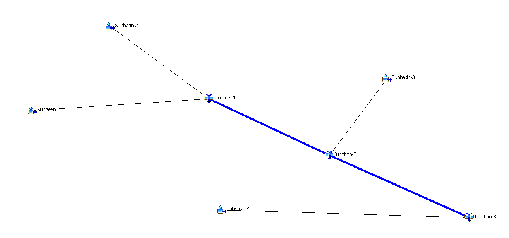
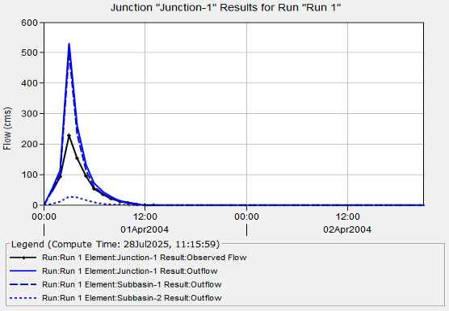
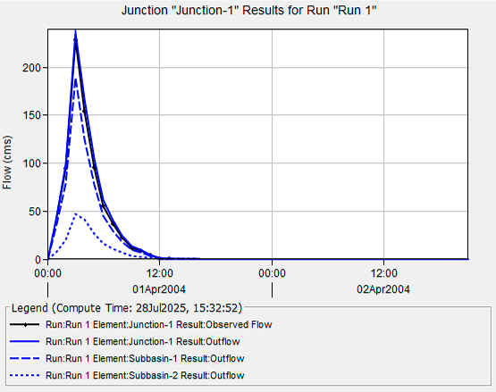
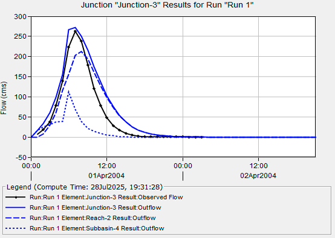
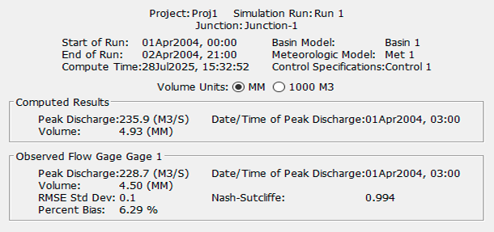
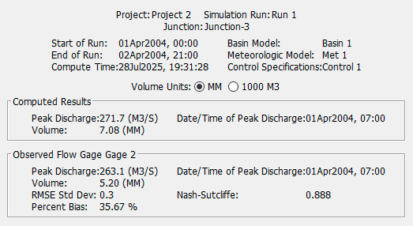
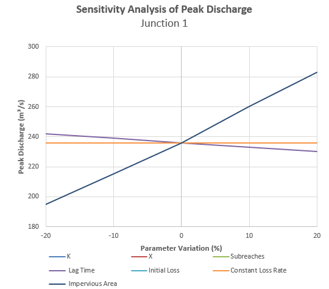

# HEC-HMS Project Images

This folder contains selected visual materials from the HEC-HMS Rainfall-Runoff Modeling academic project, illustrating the basin model configuration, calibration process, simulation results, model performance, and parameter sensitivity analysis.

## 1. Basin Model Layout

The HEC-HMS basin model consists of four subbasins, three junctions, and two routing reaches.

## 2. Junction 1 – Before Calibration

Comparison of observed and simulated discharge hydrographs before model calibration.

## 3. Junction 1 – After Calibration

Comparison of observed and simulated discharge hydrographs following model calibration, showing improved agreement.

## 4. Junction 3 – Final Hydrograph

Final simulated and observed discharge hydrographs at Junction 3, illustrating the downstream model response.

## 5. Junction 1 – Calibration Statistics

Selected model performance results:

- Simulated peak discharge: 235.9 m³/s
- Observed peak discharge: 228.7 m³/s
- Nash–Sutcliffe Efficiency (NSE): 0.994
- Percent Bias (PBIAS): 6.29%

## 6. Junction 3 – Calibration Statistics

Selected model performance results:

- Simulated peak discharge: 271.7 m³/s
- Observed peak discharge: 263.1 m³/s
- Nash–Sutcliffe Efficiency (NSE): 0.888
- Percent Bias (PBIAS): 35.67%

The model reproduced the observed peak discharge reasonably well, although the volume bias remained relatively high.

## 7. Sensitivity Analysis

Sensitivity analysis of peak discharge at Junction 1 for parameter variations ranging from −20% to +20%.

- Impervious area showed the greatest sensitivity.
- Increasing lag time reduced peak discharge.
- K, X, subreaches, initial loss, and constant loss rate showed no discernible change in peak discharge within the tested range.

The curves for parameters with identical results overlap in the graph.

---

These images document the hydrological modeling, calibration, performance evaluation, and sensitivity analysis conducted during the academic project.
