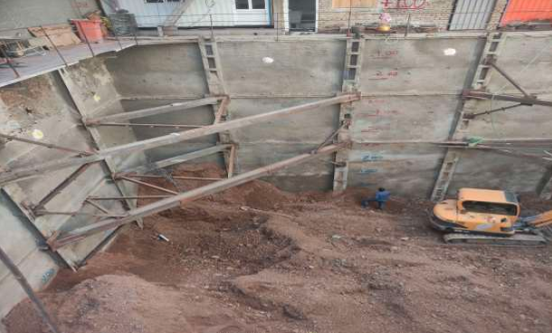
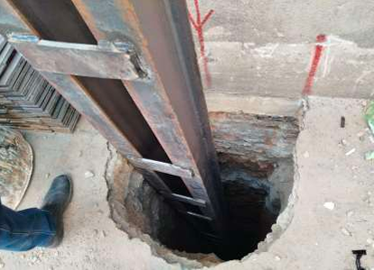
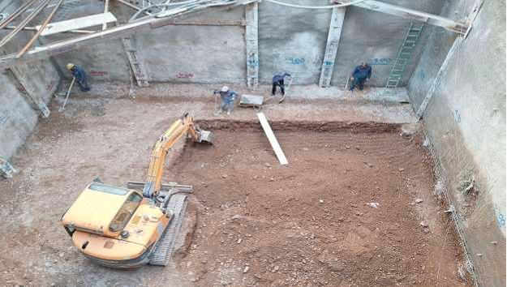

# Civil Engineering Internship: Deep Excavation and Retaining Systems

**Type:** Professional Internship – Construction Site Supervision  
**Position:** Site Engineering Intern  
**Duration:** June 2025 – September 2025 (3 Months)  
**Organization:** [Zamin Run Rosh Co.](https://zamin-run.com/en/about-us/)  
**Project Site:** Pourmousa Residential Building Project  
**Field:** Civil and Geotechnical Engineering  
**Report Date:** September 2025

## Project Overview

A three-month professional internship at Zamin Run Rosh Co., a geotechnical and foundation engineering contractor, focused on building excavation, temporary retaining structures, construction site supervision, and daily progress monitoring.

The Pourmousa Project involved the construction of a residential building with three basement levels, approximately six above-ground floors, and a steel structural system.

The temporary excavation support system consisted of steel cross-bracing (struts), vertical steel members, steel mesh, and shotcrete.

*Figure 1. General view of the excavation and temporary steel cross-bracing system at the Pourmousa Project.*

## Project Specifications

| Parameter | Description |
|---|---|
| Project type | Residential building |
| Above-ground floors | Approximately 6 |
| Basement levels | 3 |
| Structural system | Steel structure |
| Soil classification | Type II |
| Excavation support system | Temporary steel cross-bracing (struts) |
| Excavation wall surface support | Steel mesh and shotcrete |
| Internship duration | 3 months |
| Internship period | June–September 2025 |

## My Responsibilities

During the internship, I assisted with construction site supervision and carried out the following activities:

- **Excavation Monitoring:** Monitored daily excavation activities, construction progress, excavation sequencing, and depth.
- **Retaining System Monitoring:** Followed the construction progress of vertical steel members and temporary cross-bracing elements.
- **Surface Support Monitoring:** Observed steel mesh installation and shotcrete application.
- **Construction Machinery:** Followed excavation machinery operations and their coordination with other site activities.
- **Site Safety Awareness:** Observed site conditions and potential excavation-related hazards.
- **Daily Progress Reporting:** Prepared daily construction progress reports and submitted them to the company.

## Selected Site Photographs

The following photographs were personally taken during the internship and document actual construction activities at the Pourmousa Project.

### Vertical Steel Members

*Figure 2. Vertical steel member associated with the temporary excavation support system.*

### Steel Mesh and Shotcrete

*Figure 3. Steel mesh and shotcrete-related activities along the excavation walls.*

### Excavation Operations

*Figure 4. Excavation machinery and earthwork activities within the supported excavation.*

Additional photographs are available in the [Site Images Gallery](images/).

## Technical Topics Studied

In addition to practical site experience, the internship report covered the following engineering topics:

| Technical Topic | Scope of Study |
|---|---|
| Excavation methods | Braced and unbraced excavation systems |
| Ground stabilization | Soil nailing, ground anchors, and steel struts |
| Lateral earth pressure | Earth pressure principles and retaining structure behavior |
| Excavation stability | Base heave, ground deformation, and adjacent building protection |
| Anchor testing | Load-bearing, performance, and creep testing principles |
| Retaining structures | Design fundamentals and construction considerations |
| Engineering standards | Iranian National Building Code, Part 7 (Foundations) |
| Site management | Construction coordination, risk awareness, and progress monitoring |

These topics formed the theoretical and academic component of the internship. They do not imply that all the studied methods or tests were implemented at the Pourmousa Project or personally performed by me.

## Internship Report

**Deep Excavation and Retaining Structures: Methods, Design Fundamentals, and Site Management**

The technical report combines academic engineering principles with practical observations gained during the internship.

It is organized into five main chapters:

1. Excavation
2. Fundamentals of Retaining Structure Calculations
3. Retaining Structure Construction Methods
4. Cross-Bracing (Struts)
5. Construction Site and Excavation Management

| Document | Language |
|---|---|
| [Internship Report – English Version (PDF)](report/Excavation-Training-Report-EN.pdf) | English |
| [Internship Report – Original Version (PDF)](report/Excavation-Training-Report-FA.pdf) | Persian |

## Key Skills Developed

- Construction site supervision and progress monitoring
- Daily technical reporting and documentation
- Understanding of excavation sequencing
- Familiarity with temporary retaining structures
- Practical understanding of geotechnical engineering
- Construction machinery and site coordination awareness
- Health, Safety, and Environment (HSE) awareness
- Engineering communication
- Integration of theoretical knowledge with practical site observations

## Professional Scope

This internship provided practical exposure to excavation operations, temporary retaining systems, and construction site management.

My role focused on monitoring, observation, documentation, and supporting site-supervision activities. Independent structural or geotechnical design and formal engineering approval were outside the scope of my internship responsibilities.

## Project Files

| Folder | Contents |
|---|---|
| [Report](report/) | English and Persian internship reports |
| [Images](images/) | Selected original site photographs |

---

*Site photographs were personally taken during the internship and are shared selectively, subject to company permission, privacy considerations, and the protection of confidential project information.*
