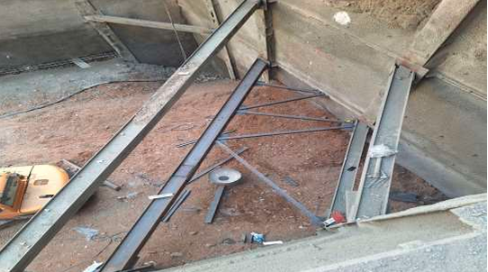
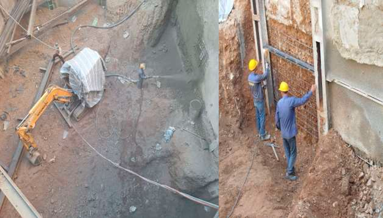

# Civil Engineering Internship: Building Excavation and Retaining Systems

**Type:** Professional Internship – Site Supervision  
**Position:** Supervisor Engineer (Intern)  
**Duration:** June 2025 – September 2025 (3 Months)  
**Organization:** [ZaminRun Ravesh](https://zamin-run.com/en/about-us/)  
**Project Site:** PorMousa Project  
**Report Date:** September 2025

## Project Overview

A three-month professional internship at ZaminRun Ravesh, a geotechnical and foundation engineering contractor, focused on building excavation, temporary retaining structures, construction site supervision, and daily progress monitoring.

The internship provided practical exposure to excavation operations, temporary excavation support systems, construction machinery, site safety considerations, and engineering progress reporting.

*Figure 1. Overview of the building excavation and temporary steel bracing system at the project site.*

## Project Characteristics

| Parameter | Description |
|---|---|
| Building type | Residential |
| Basement levels | 3 |
| Above-ground floors | Approximately 6 |
| Structural system | Steel structure |
| Soil classification | Type II |
| Excavation support system | Temporary cross-bracing (strut system) |
| Excavation wall support | Steel mesh and shotcrete |

## Practical Site Experience

The internship involved direct observation and monitoring of construction activities at the PorMousa Project.

The main construction activities included:

- Building excavation and soil removal.
- Installation of vertical steel support members.
- Implementation of temporary cross-bracing (strut) systems.
- Steel mesh installation along excavation walls.
- Shotcrete application for excavation wall support.
- Excavation machinery operations.
- Construction sequencing and progress monitoring.

## My Responsibilities

During the internship, I worked in a site-supervision role under the company's engineering team.

My responsibilities included:

- Monitoring daily excavation operations.
- Checking excavation progress and depth.
- Following the implementation of the temporary cross-bracing system.
- Monitoring steel mesh installation and shotcrete application.
- Observing construction machinery operations and excavation sequencing.
- Monitoring site safety conditions and observing potential construction hazards.
- Preparing daily construction progress reports and submitting them to the company.
- Documenting construction activities through site photography.

## Temporary Excavation Support System

The excavation support system implemented at the project consisted of temporary steel cross-bracing (struts), vertical steel support members, steel mesh, and shotcrete.

### Steel Cross-Bracing System

*Figure 2. Temporary steel cross-bracing elements used to support the excavation walls.*

### Steel Mesh and Shotcrete

*Figure 3. Steel mesh and shotcrete used for excavation wall surface support.*

The internship provided practical exposure to the construction sequence and implementation of these temporary support elements within an urban building excavation.

## Technical Topics Studied

In addition to practical site experience, the internship report covered several technical topics related to geotechnical engineering and excavation support systems:

- Braced and unbraced excavation systems.
- Soil nailing and ground anchoring methods.
- Temporary strut bracing systems.
- Lateral earth pressure.
- Excavation stability and ground deformation.
- Base heave and potential effects on adjacent structures.
- Ground anchor load-bearing, performance, and creep testing principles.
- Iranian National Building Code, Part 7 (Foundations).

These topics were studied as part of the technical and academic scope of the internship. They do not represent systems or tests personally executed at the project site.

## Key Skills Developed

- Construction site supervision.
- Excavation progress monitoring.
- Daily engineering reporting.
- Construction sequencing and coordination.
- Understanding of temporary excavation support systems.
- Practical geotechnical engineering knowledge.
- Construction machinery awareness.
- Health, Safety, and Environment (HSE) awareness.
- Technical documentation and site photography.
- Professional communication and teamwork.

## Site Documentation

Eight selected original photographs taken during the internship document excavation operations, vertical steel support members, temporary cross-bracing, steel mesh installation, shotcrete application, and excavation floor grading.

[View Full Site Photo Gallery](images/)

## Project Reports

The internship is documented through two versions of the technical report:

- English translation of the internship report.
- Original Persian internship report.

The reports cover practical site activities, excavation procedures, temporary retaining systems, geotechnical engineering concepts, and construction supervision.

[View Internship Reports](report/)

## Project Files

| Folder | Contents |
|---|---|
| [Reports](report/) | English and original Persian internship reports |
| [Site Images](images/) | Eight selected original construction site photographs |

## Confidentiality Note

Site photographs are shared selectively for professional portfolio purposes, subject to company permission and the protection of confidential project information.
