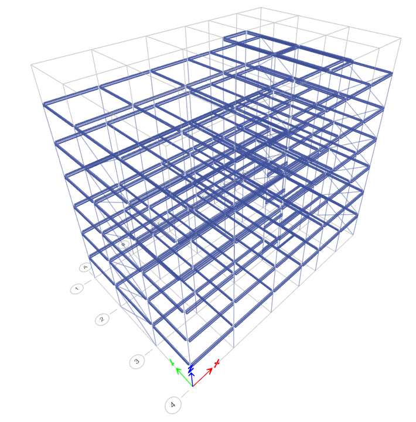
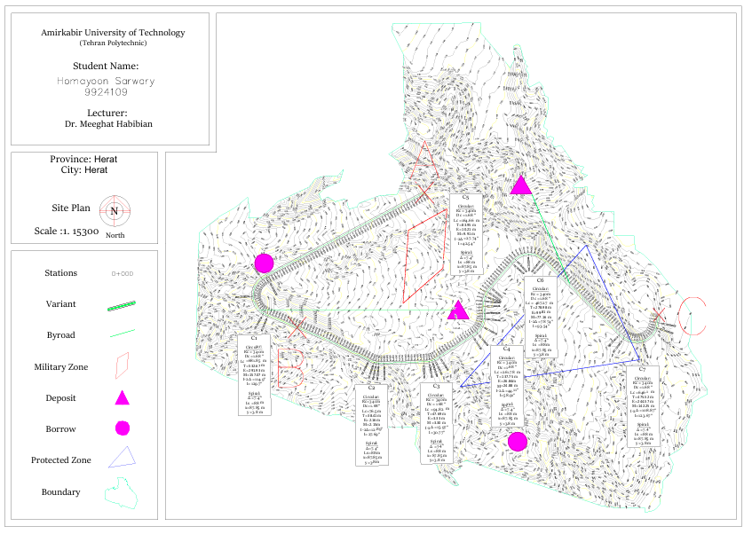
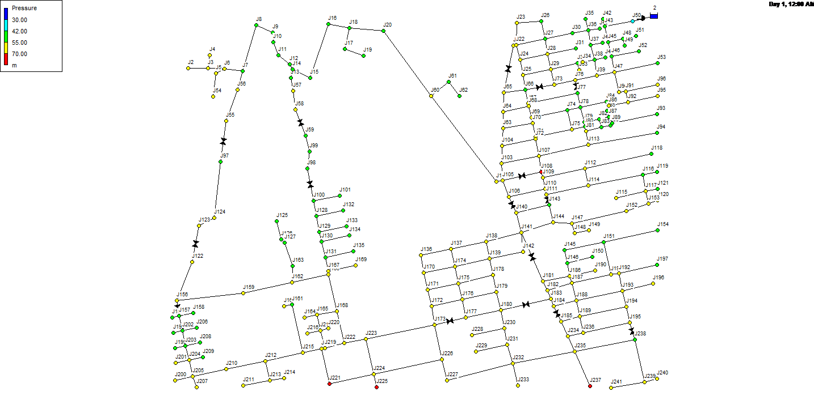

# Civil Engineering Portfolio

**Homayoon Sarwary**  
Civil Engineering Graduate  
Amirkabir University of Technology (AUT) – Tehran Polytechnic, Tehran, Iran

[Email](mailto:YOUR_EMAIL_ADDRESS) | [GitHub: Sarwary7](https://github.com/Sarwary7)

---

## About Me

I am a Civil Engineering graduate from Amirkabir University of Technology (AUT), with an academic background in structural engineering, transportation engineering, hydraulics, hydrology, and geotechnical engineering.

This portfolio presents a selection of my undergraduate engineering projects and professional internship experience, demonstrating the application of engineering principles, numerical modeling, technical analysis, design methodologies, and construction site supervision.

The repository includes technical reports, engineering models, design outputs, calculations, and selected visual documentation.

## Technical Skills

| Engineering Discipline | Technical Skills |
|---|---|
| Structural Engineering | Reinforced concrete and steel structural modeling, analysis, and design |
| Foundation Engineering | Foundation modeling and analysis |
| Transportation Engineering | Road geometric design, horizontal and vertical alignment, earthwork analysis, and traffic signage |
| Hydraulic Engineering | Water distribution network modeling, pressure and velocity analysis, and hydraulic simulation |
| Engineering Hydrology | Rainfall-runoff modeling, model calibration, and sensitivity analysis |
| Geotechnical Engineering | Excavation support systems, ground stabilization principles, and construction site observations |
| Construction Engineering | Site supervision, progress monitoring, technical reporting, and safety awareness |

## Engineering Software

| Software | Engineering Application |
|---|---|
| ETABS | Structural modeling, analysis, and design |
| SAFE | Foundation modeling and analysis |
| Autodesk Civil 3D | Road geometric design and earthwork analysis |
| AutoCAD | Engineering drawings and technical documentation |
| HEC-HMS | Hydrological modeling and rainfall-runoff simulation |

---

## Portfolio Overview

| No. | Project | Engineering Field | Project Category |
|---|---|---|---|
| 01 | [Reinforced Concrete Structures](01-Concrete-Structures/) | Structural Engineering | Academic Project |
| 02 | [Steel Structures](02-Steel-Structures/) | Structural Engineering | Academic Project |
| 03 | [Road Engineering – Herat](03-Road-Engineering-Herat/) | Transportation Engineering | Academic Project |
| 04 | [Water Distribution Network](04-Water-Distribution/) | Hydraulic Engineering | Academic Project |
| 05 | [HEC-HMS Rainfall-Runoff Modeling](05-HEC-HMS/) | Engineering Hydrology | Individual Academic Project |
| 06 | [Building Excavation and Retaining Systems](06-Excavation-Training/) | Geotechnical and Construction Engineering | Professional Internship |

---

## Selected Engineering Projects

### 01. Reinforced Concrete Structures

**Field:** Structural Engineering  
**Software:** ETABS and SAFE

Structural modeling, analysis, and design of a reinforced concrete building, including structural framing, floor systems, and foundation modeling.

  

  <em>Three-dimensional reinforced concrete structural model developed in ETABS.</em>

**Key Technical Areas:**

- Reinforced concrete structural modeling
- Structural analysis and design
- Beam and column systems
- Structural floor plans
- Foundation modeling using SAFE

[View Full Project →](01-Concrete-Structures/)

---

### 02. Steel Structures

**Field:** Structural Engineering  
**Software:** ETABS

Structural modeling and analysis of a steel building incorporating moment-resisting frames and braced structural systems.

  

  <em>Three-dimensional steel structural model illustrating beams, columns, and bracing systems.</em>

**Key Technical Areas:**

- Steel structural modeling and analysis
- Moment-resisting frames
- X-braced structural systems
- Structural member configuration
- Structural floor plans and frame elevations

[View Full Project →](02-Steel-Structures/)

---

### 03. Road Engineering – Herat, Afghanistan

**Field:** Transportation Engineering  
**Software:** Autodesk Civil 3D and AutoCAD  
**Road Length:** Approximately 12.1 km

An academic road engineering project involving geometric road design, route alignment, earthwork analysis, and traffic signage planning in Herat, Afghanistan.

  

  <em>Overview of the proposed road alignment developed using Autodesk Civil 3D.</em>

**Key Technical Areas:**

- Horizontal and vertical alignment design
- Road cross-sections
- Earthwork quantity analysis
- Mass haul diagrams
- Traffic signage and road marking plans
- Engineering drawings and design documentation

[View Full Project →](03-Road-Engineering-Herat/)

---

### 04. Water Distribution Network Design

**Field:** Hydraulic Engineering  
**Project Area:** West Saadat Abad, Tehran, Iran

Hydraulic modeling and analysis of an urban water distribution network, including the evaluation of network pressure, pipe flow velocity, and hydraulic performance over a 24-hour simulation period.

  

  <em>Spatial distribution of hydraulic pressure across the water distribution network.</em>

**Key Technical Areas:**

- Water distribution network modeling
- Hydraulic pressure analysis
- Pipe flow velocity evaluation
- Junction hydraulic performance
- Extended-period hydraulic simulation
- Interpretation of hydraulic simulation results

[View Full Project →](04-Water-Distribution/)

---

### 05. HEC-HMS Rainfall-Runoff Modeling

**Field:** Engineering Hydrology  
**Software:** HEC-HMS  
**Project Type:** Individual Academic Project  
**Watershed Area:** Approximately 1,029 km²

Development of a rainfall-runoff model for a hypothetical watershed consisting of four sub-basins, three junctions, and two routing reaches.

The project involved hydrological simulation, manual model calibration against observed discharge hydrographs, and parameter sensitivity analysis.

  

  <em>Comparison of observed and simulated discharge hydrographs after calibration at Junction 1.</em>

**Key Technical Areas:**

- Watershed and basin modeling
- Rainfall-runoff simulation
- Initial and constant loss method
- SCS unit hydrograph
- Muskingum routing
- Manual model calibration
- Parameter sensitivity analysis
- Model performance evaluation

The calibrated model achieved a Nash-Sutcliffe efficiency (NSE) of 0.994 at Junction 1. At Junction 3, the model reproduced the observed peak reasonably well, although runoff volume remained overestimated.

[View Full Project →](05-HEC-HMS/)

---

## Professional Internship Experience

### 06. Building Excavation and Retaining Systems

**Field:** Geotechnical and Construction Engineering  
**Position:** Site Supervision Intern  
**Organization:** [ZaminRun Ravesh](https://zamin-run.com/en/about-us/)  
**Project Site:** PorMousa Project  
**Duration:** June 2025 – September 2025 (3 Months)

A three-month professional internship involving construction site supervision and practical exposure to building excavation and temporary retaining systems.

The project involved a residential building with three basement levels, approximately six above-ground floors, and a steel structural system.

  

  <em>Site photograph documenting the excavation and temporary steel cross-bracing system.</em>

**Main Responsibilities and Practical Experience:**

- Monitoring daily excavation operations
- Checking excavation progress and depth
- Following temporary steel cross-bracing construction
- Monitoring steel mesh installation and shotcrete application
- Observing construction machinery operations
- Monitoring site conditions and potential safety hazards
- Preparing and submitting daily construction progress reports

The internship provided practical exposure to geotechnical engineering, temporary excavation support systems, construction procedures, and professional site reporting.

[View Full Internship Documentation →](06-Excavation-Training/)

---

## Repository Documentation

Depending on the project, the repository includes:

- Project briefs and engineering objectives
- English technical summaries and reports
- Original academic reports
- Engineering calculations and design outputs
- Original engineering software model files
- Structural models and technical drawings
- Simulation results and performance evaluations
- Selected project images and construction site photographs

Each project directory contains a dedicated README describing its scope, technical methodology, available documentation, and individual contributions where applicable.

## Academic and Professional Scope

The engineering projects presented in this repository were developed as part of my undergraduate civil engineering studies at Amirkabir University of Technology (AUT).

The excavation internship represents practical professional training and construction site experience.

Academic projects are presented for educational and portfolio purposes and are not represented as independently certified engineering designs.

Professional site photographs and internship documentation are shared subject to applicable company permissions and confidentiality requirements.

---

## Contact

**Homayoon Sarwary**  
Civil Engineering Graduate  
Amirkabir University of Technology (AUT) – Tehran Polytechnic

- **Email:** [Contact via Email](mailto:YOUR_EMAIL_ADDRESS)
- **GitHub:** [Sarwary7](https://github.com/Sarwary7)

---

*Civil Engineering Portfolio | Academic Projects and Professional Internship Experience*
