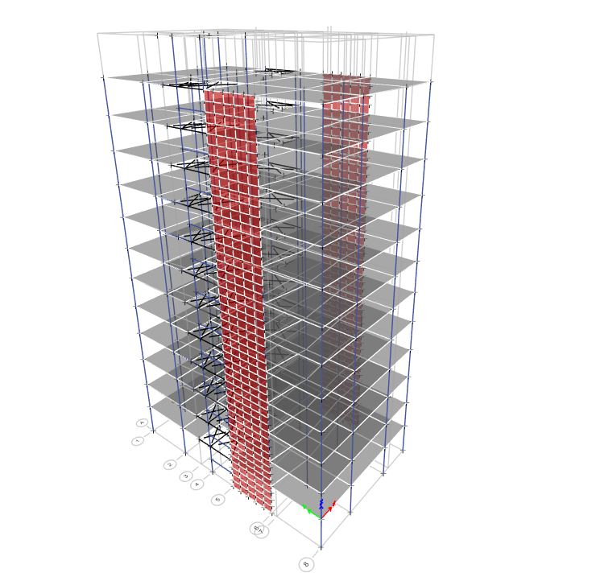
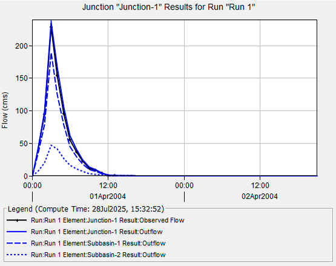
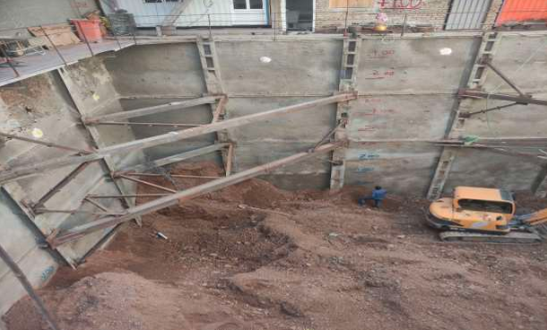

# Civil Engineering Portfolio

**Homayoon Sarwary**  
Civil Engineering Graduate  
Amirkabir University of Technology (AUT) – Tehran Polytechnic, Tehran, Iran

**📧 Email:** [homayon.sarwary77@gmail.com](mailto:homayon.sarwary77@gmail.com)  
**💻 GitHub:** [Sarwary7](https://github.com/Sarwary7)

---

## About Me

I am a Civil Engineering graduate from Amirkabir University of Technology (AUT), with an academic background in structural engineering, transportation engineering, hydraulics, hydrology, and infrastructure design, complemented by practical experience in construction site supervision.

My academic projects involve reinforced concrete and steel structural design, road geometric design, urban water distribution network modeling, and rainfall-runoff simulation.

My professional internship provided practical exposure to building excavation, temporary retaining systems, construction progress monitoring, site safety, and daily engineering reporting.

This portfolio presents selected academic projects and professional internship experience, supported by technical reports, engineering calculations, software models, design outputs, drawings, and site photographs.

---

## Technical Skills

| Engineering Field | Technical Skills |
|---|---|
| Structural Engineering | Structural analysis, reinforced concrete design, steel design, and foundation analysis |
| Transportation Engineering | Road geometric design, horizontal and vertical alignment, earthwork, pavement design, and cost estimation |
| Water Engineering | Water distribution network design, hydraulic modeling, demand estimation, and pump selection |
| Hydrology | Rainfall-runoff modeling, manual calibration, and sensitivity analysis |
| Geotechnical Engineering | Excavation supervision, temporary retaining systems, and ground stabilization awareness |
| Construction Management | Site supervision, quantity takeoff, progress monitoring, safety awareness, and technical reporting |
| Engineering Documentation | Technical reports, engineering drawings, calculations, and interpretation of simulation results |

## Engineering Software

| Software | Engineering Applications |
|---|---|
| ETABS | Structural modeling, analysis, and design of reinforced concrete and steel buildings |
| SAFE | Foundation and slab modeling, analysis, and design |
| Autodesk Civil 3D | Terrain modeling, road geometric design, profiles, cross-sections, and earthwork calculations |
| AutoCAD | Engineering drafting, structural drawings, and infrastructure layouts |
| EPANET | Water distribution network modeling, hydraulic simulation, and water quality analysis |
| HEC-HMS | Rainfall-runoff modeling, watershed simulation, calibration, and sensitivity analysis |
| Python | Engineering data processing and Voronoi-based service-area allocation |
| Microsoft Excel | Engineering calculations, quantity estimation, data processing, and result analysis |

---

## Portfolio Overview

| No. | Project | Project Type | Main Software |
|---|---|---|---|
| 01 | [Concrete Structures](01-Concrete-Structures/) | Team Academic Project (3 Members) | ETABS, SAFE |
| 02 | [Steel Structures](02-Steel-Structures/) | Individual Academic Project | ETABS, SAFE, AutoCAD |
| 03 | [Road Engineering – Herat](03-Road-Engineering-Herat/) | Individual Route Design within a Group Report | Civil 3D, AutoCAD |
| 04 | [Water Distribution Network](04-Water-Distribution/) | Team Academic Project (3 Members) | EPANET, Civil 3D, AutoCAD, Excel, Python |
| 05 | [HEC-HMS Rainfall-Runoff Modeling](05-HEC-HMS/) | Individual Academic Project | HEC-HMS |
| 06 | [Building Excavation Internship](06-Excavation-Training/) | Professional Internship – Site Supervision | Field Experience |

---

## Academic Projects

### 01. Reinforced Concrete Structures

**Project Type:** Team Academic Project (3 Members)  
**Software:** ETABS 2022, SAFE

Structural analysis and design of a 12-storey reinforced concrete residential building in Tehran, incorporating intermediate moment frames, shear walls, waffle slabs, and a mat foundation.

**Key Engineering Activities:**

- Three-dimensional structural modeling
- Structural analysis and reinforced concrete design
- Moment frame and shear wall design
- Foundation analysis and design
- Structural material quantity estimation

  

*Three-dimensional ETABS model of the reinforced concrete building.*

[View Full Project Documentation →](01-Concrete-Structures/)

---

### 02. Steel Structures

**Project Type:** Individual Academic Project  
**Software:** ETABS 22.7.0, SAFE 22.7.0, AutoCAD

Structural analysis and design of a five-storey steel building incorporating moment-resisting and braced structural frames.

**Key Engineering Activities:**

- Three-dimensional structural modeling
- Steel member analysis and design
- Manual analysis verification
- Beam-column connection design
- Foundation analysis
- Structural drawings

  

*Three-dimensional ETABS model of the steel structural system.*

[View Full Project Documentation →](02-Steel-Structures/)

---

### 03. Road Engineering – Herat, Afghanistan

**Project Type:** Individual Route Design within a Group Report (4 Members)  
**Software:** Autodesk Civil 3D, AutoCAD  
**Route Length:** Approximately 12.1 km  
**Design Speed:** 80 km/h

Geometric design of a two-lane, two-way road in Herat, Afghanistan, based on topographic data and specified engineering design constraints.

**Key Engineering Activities:**

- Route selection and geometric design
- Horizontal and vertical alignment
- Design of 7 horizontal and 13 vertical curves
- Road cross-sections and earthwork calculations
- Original and adjusted mass-haul diagrams
- Hydrology and drainage design
- AASHTO pavement design
- Traffic signage and road markings
- Quantity takeoff and construction cost estimation

  

*Overview of the designed road alignment and surrounding topography.*

[View Full Project Documentation →](03-Road-Engineering-Herat/)

---

### 04. Water Distribution Network – West Saadat Abad, Tehran

**Project Type:** Team Academic Project (3 Members)  
**Software:** EPANET, Autodesk Civil 3D, AutoCAD, Microsoft Excel, Python  
**Study Area:** Approximately 1.9 km²  
**Initial Population:** 23,157 (2021)  
**Network Junctions:** 241

Design and hydraulic analysis of an urban water distribution network for the western Saadat Abad district of Tehran, Iran.

**Key Engineering Activities:**

- Terrain modeling and network layout
- Population forecasting and water demand estimation
- Voronoi-based junction service-area allocation using Python
- EPANET hydraulic network modeling
- Pump selection and storage calculations
- Pressure and flow velocity evaluation
- 24-hour extended-period simulation
- Residual chlorine and water quality modeling

  

*EPANET network layout and simulated nodal pressure distribution.*

[View Full Project Documentation →](04-Water-Distribution/)

---

### 05. HEC-HMS Rainfall-Runoff Modeling

**Project Type:** Individual Academic Project  
**Software:** HEC-HMS 4.12  
**Watershed Area:** Approximately 1,029 km²

Development of a hydrological rainfall-runoff model for a hypothetical watershed consisting of four sub-basins, three junctions, and two routing reaches.

**Key Engineering Activities:**

- Watershed and basin modeling
- Rainfall-runoff simulation
- Initial and constant loss modeling
- SCS unit hydrograph transformation
- Muskingum routing
- Manual calibration against observed discharge hydrographs
- Model performance evaluation
- Sensitivity analysis of seven hydrological parameters

The final calibrated model achieved a Nash-Sutcliffe efficiency of 0.994 at Junction 1 and 0.886 at Junction 3 for the modeled event.

  

*Comparison of simulated and observed discharge hydrographs after calibration at Junction 1.*

[View Full Project Documentation →](05-HEC-HMS/)

---

## Professional Internship

### 06. Building Excavation and Temporary Retaining Systems

**Position:** Site Supervision Intern  
**Organization:** [ZaminRun Ravesh](https://zamin-run.com/en/about-us/)  
**Project Site:** PorMousa Project  
**Duration:** June 2025 – September 2025 (3 Months)

A three-month professional internship with a geotechnical and foundation engineering contractor, involving practical exposure to building excavation and temporary retaining system construction.

The project involved a residential building with three basement levels and approximately six above-ground floors.

**Responsibilities and Practical Experience:**

- Monitoring excavation progress and depth
- Observing excavation sequencing and construction machinery operations
- Following the implementation of temporary steel cross-bracing systems
- Monitoring steel mesh installation and shotcrete application
- Observing site safety conditions and potential construction hazards
- Preparing and submitting daily construction progress reports

  

*Site photograph showing the excavation and temporary steel cross-bracing system.*

[View Full Internship Documentation →](06-Excavation-Training/)

---

## Project Documentation

Depending on the scope of each project, the corresponding project directory contains:

- Project descriptions and original academic requirements
- English technical reports or report summaries
- Original academic reports
- Engineering calculations and design outputs
- Original engineering software models and associated files
- Technical drawings and visual documentation
- Simulation results and performance evaluations
- Descriptions of individual and team contributions

Each project includes a dedicated README providing an overview of its engineering methodology, project scope, selected results, and available documentation.

---

## Academic and Professional Scope

The engineering design projects presented in this portfolio were completed as part of my Civil Engineering studies at Amirkabir University of Technology (AUT).

Individual and collaborative contributions are identified within the corresponding project documentation.

The professional internship represents practical construction site experience and is distinguished from academic engineering design projects.

Academic designs and simulation results are presented for educational and portfolio demonstration purposes and are not intended as construction-ready engineering documents.

Site photographs are subject to company permission and confidentiality requirements.

---

## Contact

**Homayoon Sarwary**  
Civil Engineering Graduate  
Amirkabir University of Technology (AUT) – Tehran Polytechnic

**📧 Email:** [homayon.sarwary77@gmail.com](mailto:homayon.sarwary77@gmail.com)  
**💻 GitHub:** [Sarwary7](https://github.com/Sarwary7)

---
